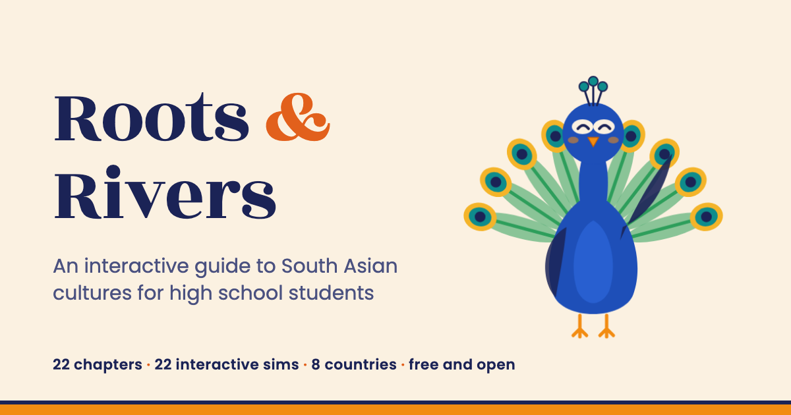

# Roots & Rivers

**An interactive guide to South Asian cultures for high school students**

[](https://aaryavvatts-lab.github.io/south-asian-culture-textbook/)
[](https://www.mkdocs.org/)
[](https://squidfunk.github.io/mkdocs-material/)
[](https://pages.github.com/)
[](https://creativecommons.org/licenses/by-nc-sa/4.0/)



**Read it here: https://aaryavvatts-lab.github.io/south-asian-culture-textbook/**

Roots & Rivers is a free, open, interactive textbook about the eight countries of South Asia (Afghanistan, Bangladesh, Bhutan, India, the Maldives, Nepal, Pakistan and Sri Lanka) and the South Asian diaspora. It covers geography, history, faiths, languages and scripts, festivals, food, music, dance, art, dress, family life, stories, cinema and cricket, science and ideas, each of the eight countries, and what it means to carry these traditions in a new country.

It is written for high school students: South Asian heritage teens who grew up with traditions they were never taught to explain, and their friends who are curious. It was created by Aaryav Sharma for the South Asian Student Association at Eastview High School in Apple Valley, Minnesota, and for any school, club or family that wants to use it.

## What's inside

| | |
|---|---|
| Chapters | 22, in four parts |
| Interactive MicroSims | 22, one per chapter, plus a learning graph viewer |
| Concepts in the learning graph | 368 |
| Quiz questions | 220, with explained answers |
| References | 219 sources, every one opened and checked |
| Glossary terms | 368 |
| FAQ | 90 questions |
| Appendices | 3 (pronunciation and scripts, country fact sheets, festival calendar 2026-27) |
| Interactive data charts | population, faiths by country, South Asian Americans |
| Words | about 265,000 |

Every chapter has a story with two fictional Minnesota sophomores, Zara and Ben; an interactive MicroSim; a **Whose Story?** box showing how different communities tell the same history; an **Ask Your Elders** interview guide; Myth/Reality pairs; practice questions; 12 exercises; a quiz; and references.

### Chapters

**Part 1: Foundations.** 1 What Is South Asia? · 2 Ancient Roots · 3 Empires and Encounters · 4 Colonialism, Independence, and Partition · 5 Faiths of South Asia · 6 Languages and Scripts

**Part 2: Living Culture.** 7 Festivals Through the Year · 8 Food and the Table · 9 Music · 10 Dance and Theater · 11 Art, Architecture, and Craft · 12 Clothing and Textiles · 13 Family, Names, and Life Events · 14 Stories and Literature · 15 Cinema, Cricket, and Pop Culture · 16 Science, Math, and Ideas

**Part 3: The Eight Countries.** 17 India · 18 Pakistan and Afghanistan · 19 Bangladesh and Sri Lanka · 20 Nepal, Bhutan, and the Maldives

**Part 4: Here and Now.** 21 The South Asian Diaspora · 22 Bring It Home

## For teachers, clubs and families

- [For Teachers](https://aaryavvatts-lab.github.io/south-asian-culture-textbook/teachers/): pacing plans and connections to Minnesota's social studies standards (including ethnic studies), AP World History and the C3 Framework.
- [Club Kit](https://aaryavvatts-lab.github.io/south-asian-culture-textbook/club-kit/): a two-year meeting plan for South Asian student associations.
- [Oral History Project](https://aaryavvatts-lab.github.io/south-asian-culture-textbook/oral-history/): how to turn Ask Your Elders interviews into an ethical oral history project, and the community Story Archive.
- [Downloads](https://aaryavvatts-lab.github.io/south-asian-culture-textbook/downloads/): PDFs of every chapter and the full book.
- `Materials/pilot-study/`: a consent-first pre/post study kit for measuring what readers learn.

## How it was made

Aaryav Sharma created the book: chose its audience, scope and structure, wrote the rules every chapter follows (accuracy, fairness, no ranking of faiths or countries, disputed history presented as disputed), and reviewed the results. AI agents (Claude, running Dan McCreary's open intelligent-textbook framework) drafted the chapters and simulations and did most of the checking, under those rules. Every chapter then went through structural checks by script, an independent fact-check, an expert-standard pass for nuance, balance and currency, a plain-language edit verified by a fact-preservation script, and (in v1.1) a full specialist re-read. The full process is on [How This Book Was Made](https://aaryavvatts-lab.github.io/south-asian-culture-textbook/methods/), and every correction is logged on [Accuracy and Corrections](https://aaryavvatts-lab.github.io/south-asian-culture-textbook/accuracy/).

## Impact

The [Impact page](https://aaryavvatts-lab.github.io/south-asian-culture-textbook/impact/) shows live counts read from this repository's issue forms: classrooms and clubs using the book, stories shared, errors reported and expert reviewers. Nothing there is estimated. The first pilot, with the EVHS South Asian Student Association, is planned for the 2026-27 school year (see the [Roadmap](https://aaryavvatts-lab.github.io/south-asian-culture-textbook/roadmap/)).

## Get involved

- **Students:** record pronunciations, translate a chapter summary, share an Ask Your Elders story, or run a Club Kit session at your school.
- **Teachers:** try one lesson and tell us how it went.
- **Scholars:** review one chapter (about 30 minutes); reviewers are credited.
- **Everyone:** report an error or request a sensitivity review.

Details: [Get Involved](https://aaryavvatts-lab.github.io/south-asian-culture-textbook/get-involved/) · [open an issue](https://github.com/aaryavvatts-lab/south-asian-culture-textbook/issues/new/choose)

## Run it locally

```bash
python3 -m venv .venv
source .venv/bin/activate
pip install -r requirements.txt
mkdocs serve
```

Then open http://127.0.0.1:8000/south-asian-culture-textbook/. To publish: `mkdocs gh-deploy --strict`.

## Repository structure

```
docs/                 the book (chapters, sims, glossary, FAQ, appendices, front pages)
docs/chapters/NN-*/   index.md (chapter), quiz.md, references.md
docs/sims/chNN-*/     p5.js MicroSims (main.html, .js, index.md, metadata.json, screenshot)
docs/learning-graph/  learning-graph.csv/.json and quality reports
Materials/            course description, design contract, concept list, chapter plan, sources, pilot study kit
CLAUDE.md             project rules for writers and editors (voice, accuracy, sensitivity)
```

## Important notes

- Zara, Ben and their friends are fictional. Real people in the book are historical or public figures, described factually.
- Health traditions such as Ayurveda and yoga are described as traditions, not medical advice.
- Disputed territories and contested history are presented as disputed. Maps in the MicroSims are schematic and are not official depictions of borders.
- This is an independent student project, not an official publication of Eastview High School, ISD 196, or any organization named in it.

## License and acknowledgements

Licensed [CC BY-NC-SA 4.0](LICENSE.md). Built with Dan McCreary's open [intelligent textbook](https://dmccreary.github.io/intelligent-textbooks/) framework and skills, MkDocs and Material for MkDocs, and p5.js. Cite with the `CITATION.cff` file or the [How to Cite](https://aaryavvatts-lab.github.io/south-asian-culture-textbook/how-to-cite/) page.
