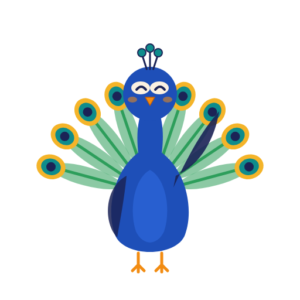
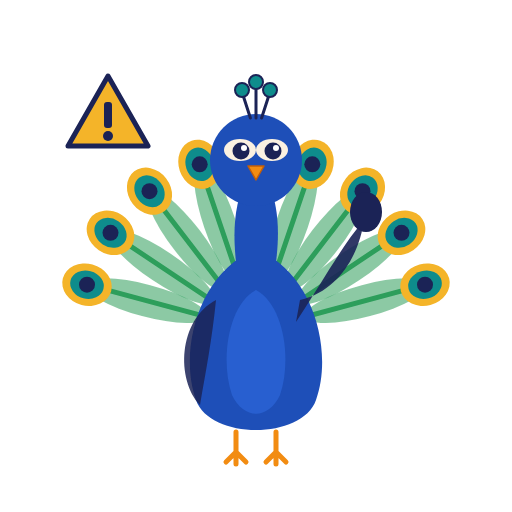
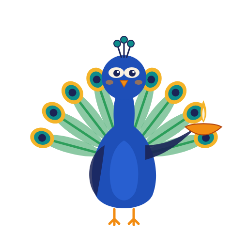
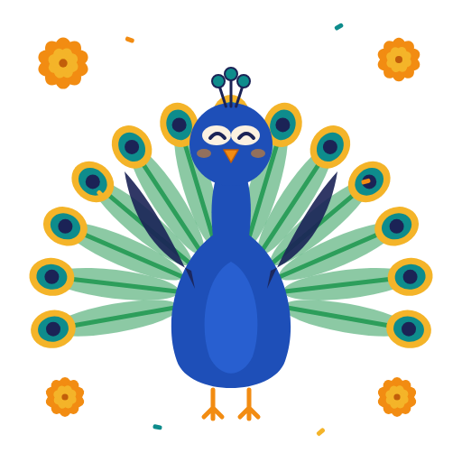

# Chapter 3: Empires and Encounters

## Summary

Between about 600 and 1800 CE, South Asia was shared by many powers at once: ocean traders and temple-building kings in the south, island kingdoms in Sri Lanka, sultans in Delhi and Bengal, the Vijayanagara emperors, the Mughals, the Marathas, the Durranis of Afghanistan, and, from 1498, European trading companies. This chapter follows those powers and the people who moved between them: merchants, poets, saints and teachers. It also follows ideas, such as the devotional poetry of the bhakti movement, the Sufi path in Islam, and the teachings of Guru Nanak. By the end you'll be able to explain why the history of this period looks less like a relay race and more like a crowded highway with many lanes.

## Concepts Covered

1. Indian Ocean Trade
2. Chola Dynasty
3. Sri Lankan Kingdoms
4. Early Islam in South Asia
5. Delhi Sultanate
6. Vijayanagara Empire
7. Bhakti Movement
8. Sufism
9. Guru Nanak
10. Mughal Empire
11. Akbar
12. Indo-Persian Culture
13. Taj Mahal
14. Maratha Empire
15. Durrani Empire
16. European Traders
17. East India Company

## Prerequisites

- [Chapter 1: What Is South Asia?](../01-what-is-south-asia/index.md), especially the monsoon and the Indian Ocean.
- [Chapter 2: Ancient Roots](../02-ancient-roots/index.md), especially the Maurya and Gupta empires.

!!! mascot-welcome "Kings, saints and spice ships"
    { class="mascot-admonition-img" }
    Hi, it's Mora! Many of the buildings in your family's photos, the foods on your table and even some of the words you use at home were shaped in the centuries this chapter covers. When someone online argues about "who ruled whom," this chapter helps you see the bigger, more crowded picture. Every tradition has a story. Let's find it!

## 3.1 "How Many Empires Were There?"

It's the second meeting of Prairie Ridge High School's South Asian Student Association. Zara Hossain has asked everyone to bring a photo of one old building from their family's home city. Ayesha Qureshi goes first. Her photo shows a huge red sandstone mosque with white marble domes. "This is the Badshahi Mosque in Lahore," she says. "My Dada calls Lahore 'the city of the Mughals.'"

Arjun Reddy holds up his phone. It shows a square stone gateway with four tall minarets. "This is the Charminar in Hyderabad. My grandmother says Hyderabad was built by the Qutb Shahi sultans, not the Mughals." Zara shows a picture her Nanu sent from Bangladesh: a low brick mosque crowned with rows of small domes. "And this one is in Bagerhat. Nanu says it's from the Bengal Sultanate."

Ben Lindqvist has been writing names on the whiteboard: Mughals, Qutb Shahis, Bengal Sultanate. He stops, marker in the air. "Wait. If the Mughals ruled Lahore, who ruled Hyderabad and Bengal? Were these all the same empire with different names? How many empires *were* there?" That question is the whole chapter.

## 3.2 A Highway, Not a Relay Race

Ben's family history can help. In the year 1100, the place we now call Scandinavia did not have one ruler. There were kings in Norway, in Denmark and in Sweden, plus earls, chieftains and trading towns, all at the same time. Sometimes they fought, sometimes they married into each other's families, and sometimes they traded. If you drew their history as a timeline, you couldn't draw a single bar. You'd need several lanes, side by side.

South Asia between 600 and 1800 works the same way, but on a much bigger scale. Many people imagine history as a relay race, where one empire hands the baton to the next: first the Guptas, then the sultans, then the Mughals, then the British. That picture is wrong in two ways.

- **Powers overlapped.** When the Mughals ruled Lahore and Agra, the Qutb Shahis ruled Hyderabad, the Kingdom of Kandy ruled the hills of Sri Lanka, and Portuguese ships controlled Goa.
- **No single power ever ruled everything.** Even the largest empires left areas to local kings, chiefs and communities.

Historians often draw this period as a set of "swim lanes": one horizontal lane per power, with bars showing when each one existed. You'll build exactly that kind of picture with the MicroSim later in this chapter. As you read, keep a rough lane in your head for each power you meet.

## 3.3 The Ocean Highway: Indian Ocean Trade

Before we meet the kings, meet the sea. **Indian Ocean Trade** is the network of sea routes and ports that linked South Asia with East Africa, Arabia, Persia, Southeast Asia and China for many centuries. It worked because of the monsoon you met in [Chapter 1](../01-what-is-south-asia/index.md). The winds blow from the southwest for part of the year and from the northeast for the rest, so sailors could ride the wind one way and come back on the reverse wind months later. Merchants were using this seasonal pattern at least as far back as Roman times.

South Asia sat right in the middle of this network. Its ports sold cotton cloth, pepper, cinnamon, gems and much more. Some of the busiest included:

| Port or coast | Today in | Known for |
|---|---|---|
| Kozhikode (Calicut), Malabar coast | Kerala, India | Pepper and spices, plus Arab, Persian, Chinese and later European visitors |
| Gujarat ports such as Cambay | Gujarat, India | Cotton textiles, links to Arabia and East Africa |
| Chattogram and the Bengal ports | Bangladesh and West Bengal | Rice, fine cotton and silk cloth |
| Galle and other harbors | Sri Lanka | Cinnamon, gems, a stopping point between east and west |
| Malé and the atolls | Maldives | A rest stop on the east-west route, and seafaring islanders |

Kozhikode, ruled by kings called the Zamorins (Samoothiris), was one of the most important ports in the world in medieval times. It welcomed Persian, Arab and Chinese traders, and famous travelers such as Ibn Battuta. Zara's family city, Chattogram, was also a busy port in this era, at the head of the Bay of Bengal.

The ocean carried more than goods. It carried people, languages, food and faiths. Traders settled in port towns, married local families, and built places of worship. That's how one of South Asia's major faiths first arrived.

### Early Islam in South Asia

**Early Islam in South Asia** means the first centuries of Muslim presence in the region, which came along several different routes, peacefully and through conquest, over hundreds of years. Islam began in Arabia in the early 600s. Arab merchants were already sailing to South Asia before then, so Muslim traders appeared on its coasts very early.

- **The Malabar coast (Kerala).** Muslim merchants settled in port towns. The Cheraman Juma Mosque in Kodungallur, Kerala, is traditionally dated to 629 CE, which would make it one of the oldest mosques in the world. Historians debate that date, and some suggest a much later building. Either way, Kerala's Muslim communities have deep roots in this trade.
- **Sri Lanka.** Arab traders arrived by the 7th century. Many Sri Lankan Muslims, often called Sri Lankan Moors, trace their ancestry to these merchant families.
- **The Maldives.** In 1153 (some records say 1193), the last Buddhist king of the Maldives became a Muslim, and the islands gradually became Muslim too.
- **Sindh (Pakistan).** In about 711 to 712, an Arab army led by Muhammad ibn al-Qasim conquered Sindh in the lower Indus valley, and it became a province of the Umayyad Caliphate.
- **The northwest.** From about 1000, Mahmud, the sultan of Ghazni (in present-day Afghanistan), led raids deep into northern India. Later rulers from the northwest founded kingdoms in North India itself.

So Islam reached South Asia through trade, through teachers and holy men, and through conquest, over many centuries. That variety is one reason Muslim communities in Kerala, Sindh, Bengal and the Maldives have such different languages, foods and customs today.

!!! mascot-thinking "Map the routes"
    { class="mascot-admonition-img" }
    I like to imagine two arrows: one sailing across the sea to the coasts of Kerala, Sri Lanka and the Maldives, and one crossing the mountains into Sindh and Punjab. Can you guess which arrow reached your family's region first?

## 3.4 Temple Builders and Island Kingdoms

### The Cholas

The **Chola Dynasty** was a Tamil royal family from the Kaveri River delta in south India. A *dynasty* is a ruling family whose power passes from one generation to the next. Cholas are mentioned in very early Tamil poems, but the empire most people mean by "the Cholas" was founded around 848 CE by a king named Vijayalaya. For the next four centuries the Cholas were one of the strongest powers in South Asia, until they were absorbed by their Pandya rivals by 1279.

Two Chola kings stand out:

- **Rajaraja I** built the enormous Brihadisvara Temple at Thanjavur between 1003 and 1010. Its main tower rises like a stone mountain over the town, and the temple is still in use today.
- **Rajendra I**, his son, led an army north as far as the Ganga, then built a new capital, Gangaikonda Cholapuram, whose name celebrates that campaign. His great temple there was completed in 1035. He also sent a naval expedition against the Srivijaya kingdom in Southeast Asia.

That last point surprises many people. The Cholas were a sea power. Tamil merchant guilds traded across the Bay of Bengal, and Chola fleets reached Sri Lanka, the Maldives and the Malay Peninsula. Three Chola temples (at Thanjavur, Gangaikondacholapuram and Darasuram) are listed together by UNESCO as the "Great Living Chola Temples," a name that reminds us that people still worship in them.

### The Sri Lankan Kingdoms

**Sri Lankan Kingdoms** is the name for the series of kingdoms that ruled the island of Sri Lanka, some Sinhala and some Tamil, often at the same time. A quick tour:

| Kingdom | Approximate dates | Capital | One thing to know |
|---|---|---|---|
| Anuradhapura | from the 4th century BCE to about 1017 CE | Anuradhapura | A Sinhala Buddhist capital for over a thousand years. Chola armies captured its last king around 1017 |
| Chola rule in the north | 993 to 1070 | Polonnaruwa | Part of the island was ruled by the Cholas for decades |
| Polonnaruwa | 1070 to 1232 | Polonnaruwa | Parakramabahu I (ruled 1153 to 1186) built huge irrigation reservoirs |
| Jaffna kingdom | 1215 to 1619 | Nallur, near Jaffna | A Tamil kingdom in the north, taken over by the Portuguese |
| Kingdom of Kandy | 1469 to 1815 | Kandy | The last independent kingdom. It kept the Buddha's Tooth Relic from 1595 and fell to the British in 1815 |

Notice how the Sri Lankan lane splits in two. From the 1200s to the 1600s a Tamil kingdom ruled the north while Sinhala kingdoms ruled further south. Dilan Perera's family is from Kandy, and the Temple of the Tooth Relic there is still one of the most important Buddhist sites in the world.

## 3.5 Sultans of Delhi and Bengal

### The Delhi Sultanate

The **Delhi Sultanate** was a series of Muslim-ruled kingdoms based in Delhi that controlled much of northern South Asia from 1206 to 1526. A *sultan* is a king, and a sultanate (سلطنت, *sul-TUH-nut*, in Urdu and Persian, "rule" or "kingdom") is the land he rules. Historians divide the Sultanate into five dynasties (ruling families):

1. Mamluk, 1206 to 1290
2. Khalji, 1290 to 1320
3. Tughlaq, 1320 to 1414
4. Sayyid, 1414 to 1451
5. Lodi, 1451 to 1526

At various times the Sultanate covered parts of today's India, Pakistan, Bangladesh and southern Nepal. Its sultans fought off Mongol armies from Central Asia, built forts and mosques, and drew scholars, poets and soldiers from Persia and Central Asia. One of its rulers was a woman: **Razia Sultan**, who ruled from 1236 to 1240 and remains the only woman to have sat on the throne of Delhi. The 72.5 m (238 ft) Qutb Minar, a red sandstone tower in south Delhi begun in the early 1200s, is the Sultanate's best-known monument.

The Moroccan traveler Ibn Battuta reached the Indus in 1333 and worked as a judge in Delhi under Sultan Muhammad bin Tughluq. Later he sailed to the Maldives. His travel book is one of our best eyewitness sources for the 1300s, and it shows how connected the Muslim world, from North Africa to the Maldives, had become.

### The Bengal Sultanate

Far to the east, Bengal had its own lane. The Bengal Sultanate ruled the delta from 1352 to 1576, independent of Delhi for most of that time, until the Mughal emperor Akbar's armies conquered it. Persian was the language of government, but some sultans and their officials also supported poets writing in Bangla, and the sultans employed both Muslims and Hindus in their government.

In the 15th century, a general named Ulugh Khan Jahan founded a city at Bagerhat in what is now Bangladesh. Its Sixty Dome Mosque (which actually has 81 domes held up by 60 columns) is the photo Zara's Nanu sent, and the city is a UNESCO World Heritage Site.

## 3.6 Vijayanagara and the Deccan

### The Vijayanagara Empire

In 1336, two brothers named Harihara and Bukka founded a kingdom in the south. It grew into the **Vijayanagara Empire**, a large Hindu-ruled empire of southern India from 1336 to 1646, named after its capital city, Vijayanagara ("city of victory"). The ruins of that city are at Hampi, in Karnataka.

Vijayanagara was strongest under Krishnadevaraya, who ruled from 1509 to 1529. Its capital was one of the biggest cities in the world in its day, with markets described by foreign visitors such as the Persian envoy Abdur Razzaq and the Portuguese traveler Domingo Paes, and its kings supported poetry in Telugu, Kannada, Tamil and Sanskrit.

In 1565 an alliance of Deccan sultanates defeated Vijayanagara at the Battle of Talikota. UNESCO notes that the capital was then plundered for six months and abandoned. The empire continued in a smaller form until 1646. Today Hampi's temples, bazaars and royal buildings are a World Heritage Site.

### The Deccan sultanates

Vijayanagara's northern neighbors were also important. The Bahmani Sultanate, founded in 1347, was the first independent sultanate of the Deccan Plateau. By 1518 it had split into five smaller sultanates. One of them, Golconda, was ruled by the Qutb Shahi family from 1518 until 1687.

This is where Arjun's grandmother comes in. In 1591, Sultan Muhammad Quli Qutb Shah moved his capital to a new city, Hyderabad, and built the Charminar at its center. The Qutb Shahis began with Persian as their court language, but in the 1600s Telugu came to be used alongside it, and many royal orders were written in both languages. Arjun's family speaks Telugu, so the language of his home was once a language of a sultan's court. The Mughal emperor Aurangzeb conquered Golconda in 1687.

!!! mascot-warning "Don't read today's politics backward"
    { class="mascot-admonition-img" }
    It's tempting to sort these wars into "Hindu side" and "Muslim side," but alliances crossed faith lines all the time. Sultans had Hindu generals and ministers, Hindu kings hired Muslim soldiers, and kingdoms of the same faith fought each other constantly.

## 3.7 Paths of Devotion: Bhakti, Sufism and Guru Nanak

Not all of this period's big changes came from kings. Some of the most lasting came from poets and teachers who spoke to ordinary people in their own languages.

### The Bhakti Movement

The **Bhakti Movement** was a wave of devotional poetry and practice within Hinduism that taught that loving devotion to God is open to everyone, whatever their caste, gender or education. *Bhakti* (भक्ति, *BHUK-tee*) means "devotion." It began in the Tamil country around the 6th century CE with two groups of poet-saints, the Alvars, devoted to Vishnu, and the Nayanars, devoted to Shiva. Over the next thousand years it spread north, and from the 1400s it was strong across north and east India.

Bhakti poets usually wrote in everyday languages, not in Sanskrit, so people could sing their songs at home and in the street. A few you may hear about in your own family:

- **Basavanna** (12th century, though sources give different dates), a Kannada poet in Karnataka linked with the Lingayat tradition, who criticized caste divisions.
- **Kabir** (15th century, though his exact dates are uncertain), a weaver from the Varanasi area whose sharp, short verses questioned empty ritual in both Hinduism and Islam. Hindus, Muslims and Sikhs all honor him, and some of his verses are in the Sikh scripture.
- **Mirabai** (16th century), a Rajput princess remembered for her songs of devotion to Krishna.

### Sufism

At the same time, a parallel path was growing within Islam. **Sufism** is the inward, devotional tradition of Islam, focused on the love of God and on drawing closer to God through prayer, remembrance and the guidance of a teacher. A Sufi (صوفی, *SOO-fee*, in Persian) usually belongs to an order, a chain of teachers and students.

In South Asia, the Chishti order became especially well known. Moinuddin Chishti (who died in 1236) settled in Ajmer, in Rajasthan, and his shrine there is still visited by huge numbers of people of many faiths. In Delhi, Nizamuddin Auliya (1238 to 1325) taught crowds of followers. The Chishtis are famous for *sama*, gatherings where devotional music and poetry, usually qawwali, help listeners focus on the love of God.

A Sufi saint's tomb is called a dargah (درگاہ, *dur-GAAH*, in Urdu, also meaning "threshold"). Dargahs across Pakistan, India and Bangladesh became places where Muslims and non-Muslims alike came to pray, ask for blessings and listen to music. Many historians see Sufi teachers as one important way that Islam spread among ordinary people, especially in Punjab, Sindh and Bengal, alongside trade, migration and the influence of rulers.

### Guru Nanak

**Guru Nanak** (1469 to 1539) was a spiritual teacher and poet from Punjab whom Sikhs honor as the founder of Sikhism and the first of the ten Sikh Gurus. A *guru* (ਗੁਰੂ, *GOO-roo*, in Punjabi) is a teacher or guide. Nanak was born in 1469 in the village of Talwandi, now called Nankana Sahib, in Punjab, Pakistan. Many historians give his birth date as 15 April, while Sikhs usually celebrate his birthday, Guru Nanak Gurpurab, on the full moon of the month of Kartik, in October or November. In Sikh tradition, he traveled widely, sharing his message in poetry and song, then settled in the town of Kartarpur (also in present-day Pakistan), where he lived as a farmer and householder until he died in 1539.

In Sikh tradition, Guru Nanak taught devotion to one God, honest work, sharing with others, and the equality of all people. His followers ate together regardless of caste, a practice that grew into the langar, the free community kitchen you'll meet in [Chapter 5](../05-faiths-of-south-asia/index.md). Simran Kaur Gill's family keeps a picture of Guru Nanak in their home, and her grandparents have visited Kartarpur.

Bhakti, Sufism and Sikhism are three separate traditions with their own teachings. Each came out of its own faith world. But they shared some features: poetry in local languages, music, and a focus on personal devotion rather than status. That's one reason a single qawwali singer or bhajan singer today might draw a mixed audience.

## 3.8 The Mughal Empire

### From Babur to Akbar

The **Mughal Empire** was a Muslim-ruled empire, founded by a dynasty from Central Asia, that ruled much of South Asia from 1526 until it formally ended in 1857. Its founder, Babur, was a prince descended from the Central Asian conqueror Timur. He took Kabul in 1504, and on 21 April 1526 he defeated the last Lodi sultan of Delhi, Ibrahim Lodi, at the First Battle of Panipat, north of Delhi. Babur died in 1530. His son Humayun lost the throne to a rival, Sher Shah Suri, and only won back Delhi and Agra in 1555.

The emperor most people remember is Babur's grandson. **Akbar** was the third Mughal emperor, who ruled from 1556 to 1605 and built the Mughal state into a lasting empire. He became emperor as a teenager. Over almost fifty years he took control of most of northern and central South Asia, from Kabul to Bengal, including the rich trading region of Gujarat.

Akbar is famous for how he ruled such a mixed population:

- He brought Hindu Rajput kings into his government and army as high-ranking officers, and married into Rajput families.
- In 1575 he built a hall for religious debate, the Ibadat Khana ("house of worship"), at his new capital, Fatehpur Sikri, and later invited scholars of many faiths, including Hindus, the Jain teacher Hiravijaya and Jesuit priests from Goa, to discuss their beliefs.
- He followed a policy called *sulh-i kul*, "universal peace," meaning the emperor should stand above any single faith.
- He set up a translation house that turned Sanskrit works into Persian. The best known is the *Razmnama*, a Persian version of the Mahabharata, illustrated by his court painters, who included Persians, Indian Muslims and Hindus.

Historians admire Akbar's policies of tolerance and also point out that he was a conqueror whose wars caused great suffering. Both things are true.

### Indo-Persian Culture

The Mughals inherited and expanded a way of life that had been growing since the Delhi Sultanate. **Indo-Persian Culture** is the blend of Persian and South Asian languages, literature, art, architecture, music, food and manners that developed in Muslim-ruled courts and cities of South Asia. Persian was the official language of the Delhi Sultanate, the Bengal Sultanate and the Mughal Empire, so officials, poets and scholars of every faith learned it.

You can still see and hear Indo-Persian culture all around you:

- **Language.** Mixing Persian and Arabic words with the everyday speech of the Delhi region produced Hindustani, the ancestor of today's Hindi and Urdu. The poet Amir Khusrau (who died in 1325), a follower of Nizamuddin Auliya, is honored as an early master of it.
- **Architecture.** Domes, arches, minarets, inlaid marble and gardens divided into four parts appear in Mughal buildings from Kabul to Dhaka.
- **Painting.** Mughal miniature painting mixed Persian styles with Indian subjects and artists.
- **Food.** Many families' biryanis, kormas and kebabs come from this court cooking tradition.
- **Music.** Instruments, styles like qawwali, and parts of North Indian classical music grew in this setting. You'll meet them in [Chapter 9](../09-music/index.md).

### The Taj Mahal

The most famous Mughal building is a tomb. The **Taj Mahal** is a white marble mausoleum (a large tomb) in Agra, built between about 1631 and 1648 by order of the emperor Shah Jahan in memory of his wife Mumtaz Mahal. The surrounding gardens, mosque and gateways were finished around 1653. Shah Jahan himself was later buried there beside her. UNESCO listed it as a World Heritage Site in 1983, calling it a jewel of Muslim art in India.

Shah Jahan also built the Red Fort and the Jama Masjid in Delhi and added marble palaces to the fort in Lahore. Lahore's fort, started under Akbar in 1566, and the Shalamar Gardens are a UNESCO World Heritage Site in Pakistan. Shah Jahan's son, Aurangzeb, built the Badshahi Mosque opposite the fort between 1671 and 1673. That's the mosque in Ayesha's photo, and it's why her Dada calls Lahore "the city of the Mughals."

### Height and decline

Aurangzeb ruled from 1658 to 1707. Under him the empire reached its largest size, stretching over almost all of the subcontinent, including Golconda in 1687. But his long wars in the Deccan were expensive, and after his death the empire broke apart quickly. Governors in Bengal, Hyderabad and Awadh became rulers in their own right, and new powers rose. By about 1760 the Mughal emperor controlled little more than the area around Delhi. The empire formally ended after the uprising of 1857, which belongs to [Chapter 4](../04-colonialism-and-partition/index.md).

!!! abstract "Whose Story?"
    The same rulers are often remembered very differently depending on who tells the story. Aurangzeb is a clear example: historians note that some South Asian Muslims remember him as a model of a devout ruler, while many others, including many Hindus in India, remember him mainly for destroying temples. Arguments about him still flare up in Indian politics today. Shivaji (Section 3.9) is honored as a hero by many people in India, especially in Maharashtra, a view that grew stronger during the independence movement. Many Afghans call Ahmad Shah Durrani "Ahmad Shah Baba," the father of Afghanistan, while in Punjab, which he invaded again and again, and among the Marathas, who lost to him at Panipat, many people remember him mainly as an invader. Historians try to weigh all of these memories against the evidence: court chronicles, travelers' accounts, coins, inscriptions and buildings.

## 3.9 New Powers: Marathas and Durranis

### The Maratha Empire

The **Maratha Empire** (also called the Maratha Confederacy) was a state founded by Marathi-speaking warriors in western India that grew, in the 1700s, into one of the largest powers in South Asia. Its founder, Shivaji, inherited land from his father, who had served the Bijapur sultanate. Shivaji built up his own kingdom in the hills of Maharashtra, fought both Bijapur and the Mughals, and was crowned Chhatrapati (sovereign) at the fort of Raigad in 1674.

After Shivaji, the Marathas kept fighting the Mughals and kept expanding. In the 1700s their real leaders were chief ministers called Peshwas, based in Pune, along with several powerful Maratha families who ruled their own regions. At their height, Maratha armies collected taxes across much of India. Their power ended in a series of wars with the East India Company, the last of which finished in 1818.

### The Durrani Empire

Meanwhile, a new power rose in the northwest. The **Durrani Empire** was an Afghan empire founded in 1747 by Ahmad Shah Durrani, a Pashtun military leader. From his capital at Kandahar (later moved to Kabul by his son), his empire stretched over Afghanistan, much of present-day Pakistan, and into Punjab and Kashmir. Many historians, and many Afghans, see it as the beginning of the modern country of Afghanistan.

The Durrani and Maratha lanes collided on 14 January 1761, at the Third Battle of Panipat, north of Delhi. The Durranis won, and the Marathas suffered enormous losses. Neither side gained lasting control of North India from the battle. Within a few decades, a different kind of power, a company, was in the strongest position of all.

## 3.10 Strangers from the Sea: European Traders

### Who came, and why

**European Traders** were the merchants and companies from Portugal, the Netherlands, England, France and Denmark who came to South Asia by sea from 1498 onward to buy spices, cotton cloth, indigo and other goods. For most of this period they were guests and customers of South Asian rulers, not rulers themselves.

- **The Portuguese** came first. Vasco da Gama crossed the Arabian Sea from Malindi, in present-day Kenya, and landed near Kozhikode on 20 May 1498. In 1510 the Portuguese captured Goa from the Bijapur sultanate and made it their capital in Asia. They held Goa until December 1961.
- **The Dutch** founded the Dutch East India Company (VOC) on 20 March 1602. In Sri Lanka they pushed out the Portuguese and took over the island's coasts, while the Kingdom of Kandy kept the interior.
- **The English** formed their own East India Company in 1600. The French and Danes followed with smaller companies.

!!! mascot-tip "Ask what the ships carried"
    { class="mascot-admonition-img" }
    For any trading company, ask three questions: what did it buy, who gave it permission to trade, and who protected its ships and warehouses? When the answer to the last one becomes "its own army," a trader is starting to turn into a ruler.

### The East India Company

The **East India Company** (EIC) was an English, later British, private company that received a royal charter (official permission) on 31 December 1600 to trade in Asia, and that later conquered and governed large parts of South Asia. Many readers are surprised to learn that it was not the British government. It was a business owned by investors, who hoped to profit from trade.

For its first century and a half, the Company depended on permission from Mughal emperors and regional rulers. It set up trading posts at Madras (now Chennai), Bombay (now Mumbai) and Calcutta (now Kolkata). When it picked a fight with the Mughal Empire in the war known as Child's War (1686 to 1690), it lost badly and had to beg Emperor Aurangzeb for pardon to keep trading.

Over time, though, the Company built its own armies. Most of its soldiers were South Asians called sepoys. The Company also got involved in the wars between regional powers. In the 1700s, as the Mughal Empire broke apart, the Company began to take over territory itself. Britain's Parliament began to limit and supervise it, renewing its charter only for twenty years at a time. How a trading company ended up ruling much of the subcontinent, starting with the Battle of Plassey in Bengal in 1757, is the story of [Chapter 4](../04-colonialism-and-partition/index.md). The Company was finally dissolved in 1874.

## 3.11 Back to the Whiteboard

Ben steps back from the whiteboard. It's covered in names now, with arrows everywhere. "Okay," he says, "so the answer to 'how many empires' is... a lot, and they were mostly at the same time?"

"Not just at the same time," Arjun says. "They were trading with each other, marrying into each other's families, fighting each other, and borrowing each other's languages."

Ayesha points at the Badshahi Mosque, the Charminar and the Sixty Dome Mosque. "Three photos, three different dynasties, all built by Muslim rulers, and none of them were the same empire."

Zara adds one line at the bottom: "South Asia had many lanes." Then she turns to the club. "Next meeting, everybody asks an elder about the oldest building near their family's home."

#### Diagram: Empire Swim Lanes

<iframe src="../../sims/ch03-empire-timeline/main.html" height="802px" width="100%" scrolling="no"></iframe>

[Open the Empire Swim Lanes fullscreen](../../sims/ch03-empire-timeline/main.html){ .md-button .md-button--primary }

MicroSim specification: Empire Swim Lanes

**sim-id:** ch03-empire-timeline 
**Library:** p5.js 
**Status:** Implemented 
**Bloom Level:** Analyze 
**Bloom Verb:** compare 
**Learning Objective:** The learner will compare the dates of major South Asian powers between 600 and 1800 CE and explain that many powers coexisted and overlapped rather than replacing each other one at a time.

**Canvas:** responsive width; 720 px drawing area plus 80 px control area.

**Controls:** Play / Pause button; year slider (600 to 1800); click or tap any bar.

**Behavior:** Ten lanes (Cholas, Sri Lankan kingdoms, Delhi Sultanate, Bengal Sultanate, Vijayanagara Empire, Deccan sultanates, Mughal Empire, Maratha Empire, Durrani Empire, European companies) show colored bars for each power's approximate dates. An orange year line follows the slider; bars active in that year are bright, and the panel lists every power active that year. Clicking a bar shows its dates, capital and one key fact. Powers that continued after 1800 end in an arrow. The sim starts paused at 1600.

Start by reading the panel at 1600. Seven powers in this small selection were active at the same time, from the Kingdom of Kandy in Sri Lanka to the Mughals and two European companies. Now drag the slider back to 1000 and count again, then forward to 1750. Which year has the most lanes lit up? Which has the fewest?

Then press **Play** and watch the year line sweep across. Notice that new powers usually appear while old ones are still alive, and that the Mughal bar starts in 1526, more than 300 years after the Delhi Sultanate began. Finally, click the Delhi Sultanate and the Vijayanagara bars and compare their capitals. The lanes are a selection: many other kingdoms, such as the Rajputs, the Ahoms in Assam, the Kingdom of Nepal and the Sikh kingdom of Punjab, existed too.

## Ask Your Elders

!!! note "Your interview for this chapter"
    Talk with a parent, grandparent, aunt, uncle, family friend or community elder about the oldest building, ruin or monument they remember near their home, and the stories they heard about kings, sultans, nawabs, rajas or traders. If you don't have a South Asian elder to ask, interview a club advisor, a local temple, mosque, gurdwara or cultural center volunteer, or a classmate's family (with permission). Ten minutes is enough.

**Before you start:** Look up a photo of a famous building from your elder's home region (a fort, temple, mosque, tomb or market) and show it to them to get the conversation going. Ask if it's okay to take notes.

**Questions to ask**

1. What was the oldest building or ruin near the place you grew up? Did you ever visit it as a child?
2. Who did people say built it, and when? Were there any legends about it?
3. Did your family or town have stories about a king, sultan, nawab, raja or famous saint from long ago?
4. Were there shrines, temples, gurdwaras or dargahs near home that people of different faiths visited?
5. How has that building or place changed since you were young? Is it looked after, crowded with tourists, or forgotten?
6. Which part of your region's history do you most want me to remember, and why?

**Listen for:** names that connect to the Mughal Empire, the Delhi Sultanate, the Vijayanagara Empire or the Sri Lankan Kingdoms; stories about saints that connect to Sufism, the Bhakti Movement or Guru Nanak; and memories of trading towns that link to Indian Ocean Trade.

**Save it:** Write down one quote or story in their words, with their permission. If they agree, you can share it with the [Roots & Rivers Story Archive](../../oral-history.md).

??? question "Your turn: compare two answers"
    Find the building your elder named in this chapter or in the Empire Swim Lanes sim. Does their story about who built it match the historical dates? If a friend interviewed someone from a different region, place both buildings on the swim lanes. Were they built under the same power, or under two powers that existed at the same time?

*"Every family does it a little differently, and there is no wrong answer here."*

## Common Misconceptions

**Myth:** Islam arrived in South Asia only by conquest.  
**Reality:** Muslim traders were living on the coasts of Kerala and Sri Lanka by the 7th and 8th centuries, the Maldives became Muslim after its king converted in the 12th century, and Sufi teachers drew many followers in Punjab, Sindh and Bengal. Conquest was one route among several.

**Myth:** The Mughals ruled all of South Asia.  
**Reality:** Even at its largest, under Aurangzeb, the Mughal Empire never included Sri Lanka, Nepal, Bhutan or the Maldives, and many regional kings inside it kept real power. For most of the Mughal period other powers, such as the Deccan sultanates, the Kingdom of Kandy, the Portuguese and later the Marathas, existed alongside it.

**Myth:** The Taj Mahal is a palace.  
**Reality:** The Taj Mahal is a mausoleum, a tomb built by Shah Jahan for his wife Mumtaz Mahal, who is buried there. Shah Jahan was later buried beside her.

**Myth:** The East India Company was the British government.  
**Reality:** It was a private company owned by investors, with a royal charter to trade. It later built armies and ruled territory, and Parliament increasingly regulated it, but it only handed India over to direct rule by the British Crown in 1858.

**Myth:** Each empire neatly replaced the one before it.  
**Reality:** Powers overlapped for decades or centuries. The Delhi Sultanate, the Bengal Sultanate, Vijayanagara, the Bahmani Sultanate and the Kingdom of Kandy all existed in the 1400s at the same time.

## Check Yourself

??? question "1. What natural pattern made long-distance Indian Ocean Trade possible?"
    The monsoon winds, which blow from the southwest for part of the year and from the northeast for the rest, so sailors could travel one way and return months later.

??? question "2. Name two Chola achievements."
    Rajaraja I built the Brihadisvara Temple at Thanjavur (1003 to 1010), and Rajendra I built a new capital at Gangaikonda Cholapuram and sent a navy to Southeast Asia.

??? question "3. What do the Bhakti Movement and Sufism have in common, and how are they different?"
    Both stress personal, loving devotion to God, often through poetry and music in local languages. Bhakti grew within Hinduism, while Sufism is a tradition within Islam.

??? question "4. Why is Akbar remembered for his religious policies?"
    He included Hindu Rajput nobles in his government, held debates among scholars of many faiths at the Ibadat Khana, followed a policy of "universal peace" (sulh-i kul), and had Sanskrit works translated into Persian.

??? question "5. In what year was the English East India Company chartered, and what kind of organization was it?"
    It received its royal charter on 31 December 1600. It was a private trading company owned by investors, not the British government.

## Exercises

### Remember

1. List the five dynasties of the Delhi Sultanate in order.

    ??? note "Answer"
        Mamluk, Khalji, Tughlaq, Sayyid and Lodi (1206 to 1526).

2. Who founded the Durrani Empire, and in what year?

    ??? note "Answer"
        Ahmad Shah Durrani founded it in 1747, with its capital at Kandahar.

### Understand

3. Explain in your own words what Indo-Persian Culture means, with two examples you could find in a South Asian family today.

    ??? note "Answer"
        It is the blend of Persian and South Asian languages, art, food and manners that grew in Muslim-ruled courts. Examples include Hindustani words in Hindi and Urdu, biryani and kebabs, qawwali music, and buildings with domes and arches.

4. Explain why Arjun's grandmother says Hyderabad was built by the Qutb Shahis, not the Mughals.

    ??? note "Answer"
        Hyderabad was founded by Sultan Muhammad Quli Qutb Shah of Golconda, who built the Charminar in 1591. The Mughals only conquered Golconda in 1687, almost a century later.

### Apply

5. Use the Empire Swim Lanes sim to find a year when at least one power was active in every one of these regions: Sri Lanka, the Deccan, North India and the coast (European companies). Write the year and list the powers.
    *Hint: try years between 1500 and 1650.*

6. A cousin visiting Lahore sends you photos of the Badshahi Mosque and the Lahore Fort. Write a three-sentence caption for each photo, using dates from this chapter.
    *Hint: the fort and the mosque were built under different emperors.*

### Analyze

7. Compare the Delhi Sultanate and the Mughal Empire. Give two similarities and two differences.
    *Hint: think about dates, founders, capitals, language and how they ended.*

8. The chapter says Islam reached South Asia "through trade, through teachers and holy men, and through conquest." Analyze which of these routes mattered most in Kerala, in Sindh and in the Maldives, using evidence from the chapter.
    *Hint: different regions had different first contacts.*

### Evaluate

9. Some people call Akbar "the Great" because of his tolerance, while others point out that he was a conqueror. Write a short paragraph evaluating whether "Akbar the Great" is a fair title, using evidence from both sides.
    *Hint: a strong answer can agree with part of each view.*

10. A website says, "The British conquered India in 1600." Evaluate this claim. What is right and wrong about it, and how would you rewrite it accurately?
    *Hint: who received the charter in 1600, and what was it allowed to do?*

### Create

11. Draw your own swim-lane timeline for your family's home region (or another region you choose) from 1000 to 1800. Include at least four powers, with start and end dates, and one building for each.
    *Hint: the Empire Swim Lanes sim and the Sri Lanka table are good models.*

12. Write a short dialogue (150 to 200 words) between a Persian-speaking official at the Mughal court and a Portuguese merchant in Goa in 1600, each explaining what they want from the other.
    *Hint: use at least three concept labels from this chapter.*

## Key Takeaways

- Between about 600 and 1800, South Asia was shared by many powers at once. History in this period looks like parallel lanes, not a relay race.
- Indian Ocean Trade, powered by the monsoon winds, linked South Asia's ports with Africa, Arabia and Southeast Asia, and carried goods, people and faiths, including early Islam.
- In the south, the Chola Dynasty and the Vijayanagara Empire built great temples and cities. In Sri Lanka, Sinhala and Tamil kingdoms ruled side by side until the Kingdom of Kandy fell in 1815.
- The Delhi Sultanate (1206 to 1526) and the Mughal Empire (1526 to 1857) spread Indo-Persian Culture, from the Hindustani language to buildings like the Taj Mahal, a tomb built for Mumtaz Mahal.
- The Bhakti Movement, Sufism and the teachings of Guru Nanak brought devotion to ordinary people in their own languages.
- As the Mughal Empire weakened after 1707, the Maratha Empire and the Durrani Empire rose, and clashed at Panipat in 1761.
- European Traders arrived by sea from 1498. The East India Company, a private company chartered in 1600, would later turn from trader to ruler.

!!! mascot-celebration "You can read the lanes!"
    { class="mascot-admonition-img" }
    You can now explain how many powers shared South Asia, and why your family's favorite old building might belong to a dynasty you'd never heard of. Next, in Chapter 4, the trading company becomes a ruler, and South Asia's road to independence and Partition begins.
