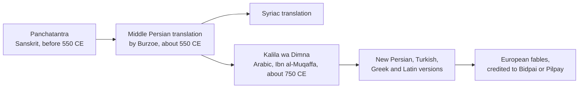

# Chapter 14: Stories and Literature

## Summary

South Asia has been telling stories for thousands of years, first out loud and later in writing, in dozens of languages. This chapter starts with oral tradition and the two great Sanskrit epics, the Ramayana and the Mahabharata, then follows the animal fables of the Jatakas and the Panchatantra as they travel to Persia, the Arab world and Europe. You'll meet Tamil Sangam poetry, the playwright Kalidasa, the poet-saint Kabir, the ghazals of Mirza Ghalib, and three modern poets who became symbols of nations: Rabindranath Tagore, Kazi Nazrul Islam and Allama Iqbal. The chapter ends with the literature of Partition and with South Asian writing in English and in translation. The big idea is that good stories rarely stay in one language, faith or country.

## Concepts Covered

1. Oral Tradition
2. Ramayana
3. Mahabharata
4. Bhagavad Gita
5. Jataka Tales
6. Panchatantra
7. Sangam Literature
8. Kalidasa
9. Kabir
10. Akbar and Birbal Tales
11. Mirza Ghalib
12. Rabindranath Tagore
13. Kazi Nazrul Islam
14. Allama Iqbal
15. Partition Literature
16. South Asian English Writing

## Prerequisites

- [Chapter 2: Ancient Roots](../02-ancient-roots/index.md), for the early history behind the epics
- [Chapter 4: Colonialism, Independence, and Partition](../04-colonialism-and-partition/index.md), for the events behind Partition literature
- [Chapter 5: Faiths of South Asia](../05-faiths-of-south-asia/index.md), for Hindu, Buddhist, Sikh and Muslim traditions that shaped many stories
- [Chapter 6: Languages and Scripts](../06-languages-and-scripts/index.md), for the languages these works were written in

!!! mascot-welcome "Pull up a chair"
    { class="mascot-admonition-img" }
    Hi, it's Mora! You probably already know some of these stories, from a bedtime tale, a cartoon, a holiday play or a line your grandparent quotes at dinner. This chapter shows you where those stories came from and how they keep changing, so the next time a relative says "that's not how it goes," you'll know why both of you might be right. Every tradition has a story. Let's find it!

## 14.1 Two Ramayanas at One Lunch Table

It's Thursday lunch at Prairie Ridge High School. "I watched six episodes of an animated Ramayana series last night," Ben Lindqvist says. "Prince Rama gets sent into the forest, the demon king Ravana kidnaps Sita, and a monkey army builds a bridge to an island to rescue her. It's basically a superhero movie."

Dilan Perera, whose family is Sinhala-speaking and Buddhist and comes from Kandy in Sri Lanka, laughs a little. "That island is supposed to be Lanka," he says. "My grandfather tells some of it differently. In his version Ravana isn't really a monster. He's a brilliant king, a scholar who played music. Some people back home are proud of him."

Zara Hossain jumps in. "My Nanu knows the story too, from growing up in Bangladesh, and she tells it with Bengali details I've never seen in any cartoon." Ben puts his fork down. "Okay, wait. If everyone tells it differently, which one is the *real* Ramayana?" This chapter is the long answer.

## 14.2 Stories Are Like Songs With Many Covers

Think about a famous song that many artists have covered. Each cover keeps the melody you recognize but changes the speed, the instruments, maybe a few words, and nobody calls it "fake." Many South Asian stories work the same way. For most of history they were not books. They were performances.

**Oral Tradition** is the passing of stories, poems, songs and knowledge from person to person by speaking, singing and memorizing, often across many generations, instead of by writing them down. In South Asia, oral tradition has carried everything from holy texts to grandmothers' bedtime stories. Many languages have an everyday word for a story told this way. In Hindi it might be a katha (कथा, *KUH-thaa*), "story," a word borrowed from Sanskrit. Zara's Nanu calls a story a golpo (গল্প, *GOL-po*), the everyday Bangla word for "story." In Urdu, a long, adventure-filled tale is a dastan (داستان, *daas-TAAN*), a word that came from Persian.

Performers learned long poems by heart, often with music and rhythm to help, and sang or acted them at festivals, temples, shrines, courts and village gatherings. Each teller could add local details, jokes and lessons for the audience in front of them.

Oral tradition is still alive. Two examples are on UNESCO's list of the world's living cultural heritage. **Ramlila**, "Rama's play," is a cycle of open-air plays retelling the Ramayana, performed across northern India during the autumn Dussehra festival. UNESCO first proclaimed it in 2005 and inscribed it on its Representative List in 2008. The **Baul songs** of Bangladesh (also sung in West Bengal, India) are devotional songs by wandering minstrels called Bauls, passed down orally from teacher to student and recognized by UNESCO on the same timeline.

In Sindh, in today's Pakistan, the poems of the Sufi poet Shah Abdul Latif Bhittai were passed around by memory and song during his lifetime and only gathered into a book, the *Shah Jo Risalo*, after he died.

!!! mascot-thinking "Think about your own family"
    { class="mascot-admonition-img" }
    Is there a story your family only tells out loud, never from a book? Notice which details change when a different relative tells it. That change is oral tradition happening right in your living room.

## 14.3 The Two Great Epics

An **epic** is a very long poem about heroes, gods, wars and journeys that a culture treats as one of its foundation stories. South Asia's two most famous epics were composed in Sanskrit, the classical language you met in [Chapter 6](../06-languages-and-scripts/index.md), and for many Hindus they are sacred texts. This section describes what they say and how scholars date them, not whether anyone's beliefs are true.

### The Ramayana

The **Ramayana** (रामायण, *raa-MAA-yuh-nuh*), "the story of Rama," is a Sanskrit epic about Prince Rama of the kingdom of Ayodhya. The best-known version is traditionally credited to the poet-sage Valmiki. Here is the story in brief:

1. Rama's stepmother persuades his father, King Dasharatha, to send Rama into the forest for fourteen years.
2. Rama goes, joined by his wife Sita and his brother Lakshmana.
3. Ravana, the ten-headed king of Lanka, kidnaps Sita and carries her to his island kingdom.
4. Rama allies with an army of vanaras (monkey-like forest people), including the devoted Hanuman.
5. They cross to Lanka, defeat Ravana and rescue Sita, and Rama returns home to be crowned.

Valmiki's Ramayana has nearly 24,000 verses, arranged in seven books. Scholars think its oral core took shape around 750 to 500 BCE, with later additions. Many Hindus see Rama as a form of the god Vishnu, and the story's themes of duty, loyalty and doing what is right run through South Asian culture. Diwali, which you met in [Chapter 7](../07-festivals/index.md), is linked in many North Indian families to Rama's return home.

### The Mahabharata

The **Mahabharata** (महाभारत, *muh-haa-BHAA-ruh-tuh*), "the great story of the Bharatas," is a Sanskrit epic about a struggle for a throne between two sets of royal cousins, the Pandavas and the Kauravas, that ends in a huge war at Kurukshetra. It is traditionally credited to the sage Vyasa, who is also a character in the story. Its longest version has more than 100,000 verses, making it one of the longest poems ever composed. Most of it was probably put together between about 300 BCE and 300 CE.

The Mahabharata is famous for being morally complicated: heroes make bad choices, villains have reasons, and characters argue about what is right.

### The Bhagavad Gita

The most famous section inside the Mahabharata is the **Bhagavad Gita** (भगवद्गीता, *BHUG-uh-vud GEE-taa*), "God's song," a poem of about 700 verses found in the epic's sixth book. Just before the great battle, the warrior prince Arjuna sees relatives and teachers on the other side and loses the will to fight. His charioteer, Krishna, whom Hindus revere as a form of Vishnu, answers his doubts in a long conversation about duty, action, devotion and the self. Scholars disagree about when it was composed. Many place it around the second or first century BCE, while others argue for earlier or later dates.

For many Hindus, the Gita is one of the most important sacred texts. Thinkers over the centuries have written commentaries on it that disagree about its deepest meaning.

| Work | Language | Rough date (scholars' estimate) | Size | What it's about |
|---|---|---|---|---|
| Ramayana (Valmiki) | Sanskrit | Oral core about 750 to 500 BCE | Nearly 24,000 verses, 7 books | Rama's exile, Sita's capture by Ravana, her rescue |
| Mahabharata | Sanskrit | Mostly about 300 BCE to 300 CE | More than 100,000 verses | A war between royal cousins and the questions it raises |
| Bhagavad Gita | Sanskrit | Debated; often placed about 2nd to 1st century BCE | About 700 verses | Krishna's answers to Arjuna's doubts before battle |

## 14.4 One Story, Many Tellings

Now back to Ben's question. Valmiki's Ramayana is the oldest well-known version, but it is far from the only one. Over the centuries, poets retold Rama's story in their own languages, for their own audiences.

- **Tamil:** In the 12th century the poet Kamban wrote the *Ramavataram*, often called the Kamba Ramayanam. Many readers count it among the greatest works of Tamil literature.
- **Bangla:** Krittibas Ojha's Bengali Ramayana, the *Krittivasi Ramayan*, dates from around the 15th century. It is full of the food, customs and village life of Bengal, and for centuries it was one of the most popular books in the region.
- **Awadhi (a language of North India):** In the 16th century, Tulsidas wrote the *Ramcharitmanas* in everyday Awadhi rather than Sanskrit, so that ordinary people could follow the story. It is the basis of the Ramlila plays.
- **Nepali:** Bhanubhakta Acharya (1814 to 1868) made the first Nepali translation of the Ramayana, which spread at first by word of mouth.
- **Beyond South Asia:** Around 870 CE, poets on the island of Java (in today's Indonesia) wrote the *Kakawin Ramayana*. Its second half is very different from Valmiki's. Thailand's *Ramakien* is one of that country's national epics. The Malay *Hikayat Seri Rama* mixes in elements from Islamic tradition.

There are also Buddhist and Jain tellings, in which parts of the plot and the meaning change.

In 1987 the scholar A. K. Ramanujan presented an essay called "Three Hundred Ramayanas: Five Examples and Three Thoughts on Translation." He chose the word **tellings** instead of "versions" on purpose, because "version" suggests there is one true original and the rest are copies. His point was that Valmiki's Ramayana is one telling among many. The essay became controversial: Delhi University assigned it to history students for several years, then voted in October 2011 to remove it from the course after objections.

!!! mascot-warning "Many tellings is not the same as 'made up'"
    { class="mascot-admonition-img" }
    For many Hindus the Ramayana is sacred, and Rama is worshipped as divine. Saying there are many tellings is a fact about how the story has been passed on, not a claim about whether anyone's faith is true, so talk about it with the same respect you'd want for your own traditions.

So what about Dilan's grandfather? In Sri Lanka, Ravana is remembered in more than one way. Many places on the island are popularly linked with scenes from the Ramayana, and the country's tourism industry promotes a "Ramayana trail" for visitors from India. At the same time, some Sinhala Buddhists have recast Ravana as a wise and noble king of the island, and that view became more popular from the 1980s on. Sri Lanka even named its first satellite, launched in 2019, Raavana-1. In Tamil literature in Sri Lanka and in South India, Ravana also appears in a positive light. One Tamil poet wrote a whole epic in which he is the hero. Historians also debate whether the Lanka of the epic was the same place as today's Sri Lanka.

!!! abstract "Whose Story?"
    The same epic means very different things depending on who is telling it. For many Hindus in India, Nepal and the diaspora, the Ramayana is a sacred story of a divine king, and Ravana's defeat is celebrated each year at Dussehra by burning his effigy. In Thailand the Ramakien is a national epic illustrated on the walls of Bangkok's Wat Phra Kaew temple, and Indonesia, a mostly Muslim country, has its own Ramayana tellings from Java and Bali. Some Sinhala Buddhists in Sri Lanka see Ravana as a proud ancient king of their island, while Tamil writers in South India and Sri Lanka have also honored him as a hero. Scholars like A. K. Ramanujan argue that none of these is the single "real" one, while others feel that treating a sacred text as one telling among many misses what makes it holy to them.

Ben gets it now. "So it's like a song with a hundred covers," he says. "The covers aren't wrong. They're for different crowds." Dilan grins. "And my grandfather would say his cover is the best one."

## 14.5 Animals Who Teach: Jatakas, Panchatantra and Birbal

Some of the most widely traveled stories in history star monkeys, jackals, lions and tortoises.

### The Jataka Tales

The **Jataka Tales** (जातक, *JAA-tuh-kuh*), "birth stories," are Buddhist stories about the earlier lives of the Buddha, before he was born as Prince Siddhartha. In these stories the future Buddha appears as a person or an animal (a monkey, a deer, a parrot, an elephant) and shows qualities like generosity, patience and courage. The Theravada Buddhist collection in the Pali language contains 547 Jatakas in a mix of verse and prose. Scholars think the verses are older than the prose stories around them, and the collection in its present form was put together around 500 CE.

Jatakas were also carved and painted: some of the earliest Jataka pictures are on the stone gateways and railings of the Buddhist stupas at Sanchi and Bharhut in India, and later murals fill the caves at Ajanta. Theravada Buddhism is the main tradition in Sri Lanka, so Jataka stories are part of many Sri Lankan childhoods, Dilan's included, as well as in Myanmar, Thailand and Laos.

### The Panchatantra

The **Panchatantra** (पञ्चतन्त्र, *PUNCH-uh-TUN-truh*), "five treatises," is a Sanskrit collection of animal fables arranged inside a frame story. In the frame, a wise teacher uses clever stories to teach three slow-learning princes how to live and rule wisely. Inside, the animals argue, scheme, make friends and pay for bad choices, and each tale has a lesson about trust, friendship or good judgment. Its author is unknown. Some versions name a teacher called Vishnu Sharma, but that may be a pen name. The Panchatantra shares many of its stories with the Jatakas, which shows how fables flowed between Hindu and Buddhist storytellers.

Then the Panchatantra went on one of the longest journeys of any book:

The Arabic version, *Kalila wa Dimna*, is named after two jackals who narrate and star in the stories. The Persian scholar Ibn al-Muqaffa's Arabic translation is still admired as a masterpiece of Arabic prose. The Library of Congress holds a digital copy of an illustrated Arabic manuscript of *Kalila wa Dimna* made in Egypt around 1310, with 73 painted pictures. From Arabic, the stories passed into many other languages, and some European writers openly credited "Bidpai" or "Pilpay, the Indian sage" as their source. One count finds about 200 versions of the Panchatantra in more than 50 languages.

### Akbar and Birbal Tales

Not all South Asian folk stories are ancient. The **Akbar and Birbal Tales** are funny stories about the Mughal emperor Akbar and his quick-witted minister Birbal, in which Birbal solves impossible puzzles, outsmarts jealous courtiers, and sometimes teases the emperor himself. Birbal was a real person: born Mahesh Das in 1528, he became one of Akbar's closest courtiers and a member of the group of advisers later called the *navaratnas*, the "nine jewels." He died in 1586, killed in battle in the Swat region of today's Pakistan. Most of the famous tales, though, are folk stories that spread much later, mainly in the 1800s, across what are now India and Pakistan, and they are still retold for children today.

## 14.6 Classical Poetry: Sangam Poems and Kalidasa

### Sangam Literature

**Sangam Literature** is the earliest known body of Tamil poetry, composed roughly between 300 BCE and 300 CE. The word Sangam (சங்கம், *SUNG-gum*) means "gathering" or "academy." According to Tamil tradition, the poems were approved by great assemblies of poets in the city of Madurai. Historians treat those legendary assemblies as tradition rather than history, but the poems themselves are very real.

The Sangam collections hold 2,381 poems by 473 poets, 102 of them anonymous. The poems fall into two big kinds:

- **Akam** (inner) poems are about love: longing, meeting, separation and jealousy.
- **Puram** (outer) poems are about public life: kings, war, generosity, death and fame.

Sangam poets also sorted poems by landscape, such as hills, pastures or seashore, so the setting of a poem helped signal its mood. Many readers find them surprisingly modern: short, vivid and about ordinary emotions. Tamil is spoken today in India's Tamil Nadu, in northern and eastern Sri Lanka, and in a large diaspora, and many Tamils around the world take pride in Sangam poetry.

### Kalidasa

**Kalidasa** was a poet and playwright who wrote in Sanskrit, probably in the fourth to fifth century CE, during the time of the Gupta kings. Very little is known about his life, and even his birthplace is debated. His surviving works include three plays and several poems. Two are especially famous:

- **Shakuntala** (full title *Abhijnanashakuntalam*), a play about a king who falls in love with a young woman raised in a forest hermitage, forgets her because of a curse, and finally recognizes her again.
- **Meghaduta**, "The Cloud Messenger," a poem in which a yaksha (a nature spirit) exiled for a year asks a passing cloud to carry a message to his wife in the Himalaya, describing the sights the cloud will pass on its way north.

The British scholar William Jones translated *Shakuntala* into English in the late 1700s, and from English it went into German, where the poet Goethe admired it.

## 14.7 Poet-Saints and the Ghazal

From around the 1400s, some of South Asia's most loved poetry came from poet-saints, devotional poets who wrote in the languages people spoke every day.

### Kabir

**Kabir** was a 15th-century poet-saint from Varanasi, in North India. Historians are unsure of his exact dates (some say 1398 to 1448, others 1440 to 1518). Tradition says he was raised by a Muslim weaver family, and he is often described as a weaver himself. Kabir composed songs and short, sharp couplets (called *dohe* or *sakhi*) in the everyday Hindi of his time. Many were passed on orally, and later admirers added verses in his name. He questioned empty ritual and hypocrisy in both Hinduism and Islam and taught that the divine is found within each person. During his lifetime he was criticized by both Hindus and Muslims, and after his death both communities claimed him.

Kabir's verses are included in the Guru Granth Sahib, the holy scripture of the Sikhs, and a community called the Kabir Panth ("Path of Kabir") honors him as its founder. Five hundred years later, Rabindranath Tagore was among the writers influenced by him.

### Mirza Ghalib and the ghazal

To understand the next poet you need one form. A **ghazal** (غزل, *GHUZ-ul*) is a poem made of separate two-line couplets that share a rhyme and a repeated ending phrase. Each couplet can stand alone like a tiny poem. The form came to South Asia through Persian and became central to Urdu poetry and music.

**Mirza Ghalib** (1797 to 1869) is the most famous ghazal poet in the Urdu language. Born in Agra, he lived most of his life in Delhi and wrote in both Urdu and Persian. He wrote far more in Persian than in Urdu, but his fame rests on his Urdu ghazals. He lived through the violence of 1857 in Delhi and spent much of his life short of money.

Before Ghalib, ghazals were mostly about painful love. Ghalib stretched the form to cover philosophy, doubt, faith, loss and the strangeness of life, often with wit. He was also a brilliant letter writer: his chatty, funny Urdu letters helped make Urdu prose more natural and easy to read. Today his couplets are quoted in India, Pakistan and the diaspora, and ghazal singers still perform them.

!!! mascot-tip "How to spot a ghazal"
    { class="mascot-admonition-img" }
    Listen for the same word or phrase coming back at the end of every couplet, like a chorus. Many famous film songs and qawwali performances are built on ghazals, so you may have heard one without knowing its name.

### Poets of the northwest

The northwest of the region, in today's Pakistan and Afghanistan, has its own beloved poets:

- **Rahman Baba** (about 1632 to 1706), a Sufi poet from Peshawar, wrote in Pashto about God, kindness and humility. He is among the most popular poets of the Pashto language, loved by Pashto speakers in both Pakistan and Afghanistan.
- **Waris Shah** wrote *Heer* in 1766, the most famous telling of Heer and Ranjha, a tragic Punjabi love story that already existed in oral and earlier written forms.
- **Shah Abdul Latif Bhittai**, as you saw in 14.2, composed Sindhi Sufi poetry that was sung and memorized before it was ever collected.

## 14.8 Poets Who Became Symbols of Nations

In the late 1800s and early 1900s, three poets became so important that countries now treat them as national symbols. All three were born in British India. Today their memories belong to India, Bangladesh and Pakistan in different ways.

### Rabindranath Tagore

**Rabindranath Tagore** (1861 to 1941) was a Bengali poet, songwriter, novelist, playwright, painter and educator from Calcutta (now Kolkata). He wrote some 2,000 songs, many novels and short stories, and founded Visva-Bharati University at Santiniketan. In 1913 he won the Nobel Prize in Literature, the first person from outside Europe to win that prize and the first Asian to win any Nobel Prize. The Nobel committee praised his "profoundly sensitive, fresh and beautiful verse," much of it from *Gitanjali* (Song Offerings), a book of song-poems he translated into English himself.

Tagore wrote the words of two countries' national anthems:

- India's anthem, "Jana Gana Mana," is the first stanza of a song Tagore wrote in Bengali. It was first sung publicly in Calcutta in 1911 and adopted as India's national anthem in January 1950.
- Bangladesh's anthem, "Amar Sonar Bangla" (আমার সোনার বাংলা, *AA-mar SHO-nar BANG-la*), "My Golden Bengal," was written by Tagore and adopted by Bangladesh's provisional government in 1971.

Sri Lanka's anthem has a Tagore connection too, but a debated one. Most historians say the Sri Lankan composer Ananda Samarakoon, who had studied under Tagore at Santiniketan, wrote both the words and music, inspired by his teacher. A minority claim Tagore wrote part or all of it, and some historians in both India and Sri Lanka reject that claim.

### Kazi Nazrul Islam

**Kazi Nazrul Islam** (1899 to 1976) was a Bengali poet, songwriter and journalist who is honored as the national poet of Bangladesh. People called him that for decades, and in December 2024 the government made the title official in a gazette notice. Born into a Muslim family in a village in what is now West Bengal, India, he served in the British Indian Army and then became a journalist in Calcutta. In 1922 he published "Bidrohi" ("The Rebel"), a thundering poem against injustice and oppression that earned him the title of *Bidrohi Kobi*, the "Rebel Poet." His writing against British rule landed him in prison more than once.

Nazrul wrote and composed nearly 4,000 songs, now known as *Nazrul Geeti*. He brought the ghazal into Bengali and also wrote Islamic devotional songs alongside Hindu devotional songs to the goddess Kali, called *Shyama Sangeet*, which upset some people on both sides. He looked up to Tagore as a mentor, and in 1923 Tagore dedicated a play, *Basanta*, to him while Nazrul was in prison. In 1942 an illness began to take away his voice and memory, and he could no longer write. In 1972 Nazrul was brought to the new country of Bangladesh, where he spent his last years.

### Allama Iqbal

**Allama Iqbal** (Sir Muhammad Iqbal, 1877 to 1938) was a poet and philosopher born in Sialkot, Punjab, in today's Pakistan. *Allama* is an honorific meaning "learned scholar." He studied in Lahore, Cambridge and Munich and wrote in Urdu and Persian. In his famous 1930 Allahabad Address he called for a separate political home for Muslims in the northwest of British India, an idea that helped shape the movement for Pakistan, which was founded nine years after his death.

Iqbal is honored as Pakistan's national poet, and his birthday, 9 November, is a public holiday there (the government restored the holiday in 2022 after dropping it in 2015). One of his best-known Persian books, *Asrar-e-Khudi* (Secrets of the Self), urges readers to build their inner strength, or selfhood. Iqbal's life shows how poetry crosses borders: one of his early Urdu songs, "Saare Jahan Se Achha" (also called "Tarana-e-Hindi"), written for children, is still a popular patriotic song in India, and his Persian poems are so loved in Iran that people there call him *Iqbal-e Lahori*, "Iqbal of Lahore."

### And in Nepal

Nepal has its own modern classic. Laxmi Prasad Devkota's long poem *Muna Madan* (1936) tells of a young husband who leaves Kathmandu for Lhasa, in Tibet, to earn money, and the wife who waits for him. Devkota and Bhanubhakta (14.4) are both major figures in Nepali literature.

| Poet | Lived | Main languages | Remembered as | Countries that honor him |
|---|---|---|---|---|
| Rabindranath Tagore | 1861 to 1941 | Bangla, English | Nobel laureate (1913); anthem writer | India and Bangladesh |
| Kazi Nazrul Islam | 1899 to 1976 | Bangla | The "Rebel Poet"; national poet | Bangladesh (and India) |
| Allama Iqbal | 1877 to 1938 | Urdu, Persian | National poet; thinker | Pakistan (and admirers in India and Iran) |

## 14.9 Partition Literature

In 1947 British India was divided into India and Pakistan, and in the violence and mass migration that followed, as you read in [Chapter 4](../04-colonialism-and-partition/index.md), huge numbers of people were killed and millions were forced from their homes, with Hindus, Muslims and Sikhs all suffering. Writers on every side tried to make sense of it.

**Partition Literature** is the poetry, fiction and memoir written about the 1947 Partition and its aftermath, in Urdu, Hindi, Punjabi, Bangla, Sindhi, English and other languages. Rather than heroes and villains, the best of it focuses on ordinary people, loss and the absurdity of drawing a line through a shared home. Three classics:

- **"Ajj Aakhaan Waris Shah Nu"** ("Today I Call on Waris Shah," 1947), a Punjabi poem by **Amrita Pritam**, who left Lahore for India in 1947. In it she calls on the 18th-century poet of *Heer* to witness the suffering of Punjab. The poem is loved on both sides of the border, and Pritam remained popular in Pakistan all her life.
- **"Toba Tek Singh"** (1955), an Urdu short story by **Saadat Hasan Manto**. It follows patients in a mental hospital in Lahore who are to be divided between India and Pakistan a few years after Partition, and one man who cannot accept that his home village has been assigned to a country. Critics read it as a bitter satire of the whole process.
- ***Train to Pakistan*** (1956), an English novel by **Khushwant Singh**, set in a fictional village on the new border where Sikhs and Muslims had lived side by side, until trains full of the dead begin to arrive.

Notice the link the Story Web will show you: Amrita Pritam's 1947 poem talks directly to Waris Shah's 1766 *Heer*. A Partition poem reached back nearly two centuries to a shared Punjabi classic, to say that the land being split had one literature.

## 14.10 South Asian English Writing

**South Asian English Writing** is literature written in English by writers from South Asia and its diaspora, as well as works translated into English that reach readers worldwide. Some milestones:

- **1905:** Rokeya Sakhawat Hossain, a Muslim writer and reformer born in 1880 in Pairaband, Rangpur (now in Bangladesh), published "Sultana's Dream" in English in a Madras magazine. It imagines "Ladyland," where women run the country and scientists use solar power and flying cars. It is one of the earliest feminist science fiction stories anywhere. Bangladesh marks her birthday, 9 December, as Rokeya Day.
- **1930s onward:** R. K. Narayan (1906 to 2001) created Malgudi, a fictional South Indian town, in his first novel, *Swami and Friends*, and returned to it again and again. His stories focus on the everyday lives of ordinary people.
- **1981:** Salman Rushdie's *Midnight's Children*, about a boy born at the very moment of India's independence, won the Booker Prize.
- **2022:** Shehan Karunatilaka, from Sri Lanka, won the Booker Prize for *The Seven Moons of Maali Almeida*, a darkly comic story about a war photographer's ghost in Colombo in 1990, during the civil war.

Translation is also bringing more South Asian books to English readers. The International Booker Prize honors books translated into English. In 2022 *Tomb of Sand* by Geetanjali Shree, translated from Hindi by Daisy Rockwell, became the first book translated from an Indian language to win it. In 2025 *Heart Lamp*, Banu Mushtaq's short stories about Muslim women in southern India, translated from Kannada by Deepa Bhasthi, became the first Kannada book and the first story collection to win.

People still debate English's place. Some argue that writing in the colonizers' language cuts writers off from the people they describe. Others answer that English is now a South Asian language too, and that, along with translation, it carries stories to readers who never learned Bangla, Urdu or Kannada.

!!! mascot-encourage "Your languages count"
    { class="mascot-admonition-img" }
    If you understand your family's language better than you speak it, like Zara does with Bangla, you already have a way into two literatures. Even reading one translated poem or story from your heritage language is a real start.

On the bus home, Zara thinks about her Nanu's golpo, Tagore's songs, Nazrul's rebel poem and Rokeya's Ladyland. They all belong to one Bengali literature, in Bangla and in English, on both sides of a border that didn't exist when most of them were written. She decides the South Asian Student Association needs a story night.

## 14.11 The Story Web

The Story Web puts thirty works and writers from this chapter on one timeline. Dots run left to right by era, colors show language groups, and lines connect works that retell, translate or answer each other.

#### Diagram: Story Web

<iframe src="../../sims/ch14-story-web/main.html" height="852px" width="100%" scrolling="no"></iframe>

[Open the Story Web fullscreen](../../sims/ch14-story-web/main.html){ .md-button .md-button--primary }

MicroSim specification: Story Web

**sim-id:** ch14-story-web 
**Library:** p5.js 
**Status:** Implemented 
**Bloom Level:** Analyze 
**Bloom Verb:** trace 
**Learning Objective:** The learner will trace how a single story or form traveled across languages, faiths and borders by following links between works on a timeline.

**Canvas:** responsive width; 760 px drawing area plus 90 px control area.

**Controls:** language filter menu, "Show all links" checkbox, Reset button; click or tap any dot.

**Behavior:** Thirty works and writers are placed in five era columns (before 1 CE, 1 to 1000 CE, 1000 to 1700, 1700 to 1947, 1947 to today) and colored by seven language groups. Twenty links connect related works, such as the Valmiki Ramayana to its Tamil, Bangla, Awadhi, Nepali and Javanese tellings, the Panchatantra to *Kalila wa Dimna*, and Waris Shah to Amrita Pritam. Selecting a dot highlights its links and shows a card with language, date, place, a one-line summary and the reason for each link. The language filter fades works not written in the chosen language. The sim starts with the Valmiki Ramayana selected.

Start with the Valmiki Ramayana, which is already selected, and follow its orange links out to the Tamil, Bangla, Awadhi, Nepali and Javanese tellings. Read the card for each and notice how many centuries and how many languages one story crossed. Then click the Panchatantra and follow it into *Kalila wa Dimna*. Which link takes a story out of South Asia entirely?

Next, use the language menu to pick "Persian," then "English," and see which eras light up. Find a link that crosses a modern border, such as Waris Shah to Amrita Pritam. Two dots, Kalidasa and Akbar and Birbal, have no links yet. What link would you draw?

## Ask Your Elders

!!! note "Your interview for this chapter"
    Talk with a parent, grandparent, aunt, uncle, family friend or community elder about the stories, poems and books they grew up with: bedtime stories, a poet or song they love, and books they read in school. If you don't have a South Asian elder to ask, interview a club advisor, a local temple, mosque, gurdwara or cultural center volunteer, or a classmate's family (with permission). Ten minutes is enough.

**Before you start:** Ask if you can record or take notes. If they mention a poem or song, write down its title and the poet's name rather than trying to copy the whole thing, and look it up together afterward.

**Questions to ask**

1. What stories did someone tell you at bedtime or when you were small? Who told them?
2. Do you remember a story with talking animals, a clever trickster, or a hero from an epic? How did it go when you heard it?
3. Is there a poet or a song you love? What is its title, and when do you think of it?
4. What books or poems did you study in school back home? Which one stuck with you?
5. Have you heard the same story told differently by someone from another region, faith or country? How has the way you tell it changed since you moved, or since you were young?
6. Which story would you most like me to remember and someday tell my own kids?

**Listen for:** signs of Oral Tradition (a story they only know from hearing it), tellings of the Ramayana or Mahabharata, animal fables like the Panchatantra or Jataka Tales, and names like Rabindranath Tagore, Kazi Nazrul Islam, Allama Iqbal or Mirza Ghalib.

**Save it:** Write down one quote or story in their words, with their permission. If they agree, you can share it with the [Roots & Rivers Story Archive](../../oral-history.md).

??? question "Your turn: compare two answers"
    Compare the bedtime story your elder told with a friend's. Did either story come from an epic or a fable collection in this chapter? Find one detail that changed between your two tellings and explain what it might tell you about the place, faith or family it came from.

*"Every family does it a little differently, and there is no wrong answer here."*

## Common Misconceptions

**Myth:** There is one true Ramayana, and other versions are copies or mistakes.  
**Reality:** Valmiki's Sanskrit Ramayana is the oldest well-known telling, but the story has been retold for centuries in Tamil, Bangla, Awadhi, Nepali, Thai, Javanese, Malay and more, plus Buddhist and Jain tellings. Scholars such as A. K. Ramanujan call them "tellings" because each is a real performance of the story for its own audience.

**Myth:** South Asian literature is all religious.  
**Reality:** Some of the most famous works are sacred texts, but the region also has Sangam love and war poems, Kalidasa's romantic plays, Ghalib's witty ghazals and letters, Akbar and Birbal comedies, Rokeya's feminist science fiction, Partition stories and modern novels about everyday life.

**Myth:** Urdu poetry is only about romantic love.  
**Reality:** The ghazal began as love poetry, but Mirza Ghalib used it for philosophy, doubt and loss, and Allama Iqbal wrote Urdu and Persian poems about selfhood, faith and politics. Urdu literature also includes Manto's sharp Partition stories.

**Myth:** Writing in English isn't "real" South Asian literature.  
**Reality:** South Asians have written in English for more than a century, from Rokeya Sakhawat Hossain's "Sultana's Dream" (1905) to Booker Prize winners from India and Sri Lanka. Translation into English, such as the International Booker winners of 2022 and 2025, also carries Hindi and Kannada stories to readers worldwide.

## Check Yourself

??? question "1. What is oral tradition, and why does it lead to many versions of the same story?"
    Oral tradition is passing stories and poems from person to person by speaking, singing and memorizing. Because each performer adapts the story for a new audience, details change from teller to teller and place to place.

??? question "2. How is the Bhagavad Gita related to the Mahabharata?"
    The Bhagavad Gita is a section of about 700 verses inside the Mahabharata's sixth book. It is the conversation between Krishna and Arjuna just before the great battle.

??? question "3. Name two places outside South Asia where the Panchatantra's stories traveled, and what the Arabic version is called."
    The stories went to Persia (in a Middle Persian translation around 550 CE) and the Arab world, and from there to Europe. The Arabic version, translated by Ibn al-Muqaffa around 750 CE, is called *Kalila wa Dimna*.

??? question "4. Which poet's words are used in the national anthems of both India and Bangladesh?"
    Rabindranath Tagore wrote both "Jana Gana Mana" (India) and "Amar Sonar Bangla" (Bangladesh). He also won the Nobel Prize in Literature in 1913.

??? question "5. What does Amrita Pritam's Partition poem have to do with an 18th-century poet?"
    Her 1947 Punjabi poem calls on Waris Shah, who wrote the famous *Heer* in 1766, to witness the suffering of Punjab during Partition. It links a Partition poem to a classic shared by Punjabis in both India and Pakistan.

## Exercises

### Remember

1. List three languages, other than Sanskrit, in which the Ramayana has been retold, and name the poet for each.

    ??? note "Answer"
        Any three of: Tamil (Kamban, 12th century), Bangla (Krittibas Ojha, about 15th century), Awadhi (Tulsidas, 16th century), Nepali (Bhanubhakta Acharya, 19th century).

2. Match each poet to the country that honors him as its national poet: Kazi Nazrul Islam, Allama Iqbal.

    ??? note "Answer"
        Kazi Nazrul Islam is the national poet of Bangladesh. Allama Iqbal is the national poet of Pakistan.

### Understand

3. Explain the difference between akam and puram poems in Sangam Literature.

    ??? note "Answer"
        Akam ("inner") poems are about love and private feelings such as longing and separation. Puram ("outer") poems are about public life, such as kings, war, generosity and fame.

4. Explain why A. K. Ramanujan preferred the word "tellings" to "versions."

    ??? note "Answer"
        "Version" suggests there is one original and everything else is a copy. "Telling" treats each Ramayana as a real performance of the story in its own language and setting, with Valmiki's as one telling among many.

### Apply

5. Use the Story Web to find every work in the 1700 to 1947 column that is written in Bangla. For each one, write the link the sim shows and the reason for it.
    *Hint: use the language menu, then click each lit dot.*

6. Your little cousin asks why Birbal is in stories with Emperor Akbar if "they're just cartoons." Using facts from 14.5, write a three-sentence answer that separates the real Birbal from the folk tales.
    *Hint: think about dates, and when the stories spread.*

### Analyze

7. Compare the journey of the Ramayana with the journey of the Panchatantra. How are the routes different, and what does each journey tell you about how stories travel (through faith, trade, translation or performance)?
    *Hint: one moved mainly east and the other mainly west.*

8. Tagore, Nazrul and Iqbal were all born in British India, but today they are honored by different countries. Analyze how the borders drawn in 1947 and 1971 changed the way each poet is remembered.
    *Hint: look at the "Countries that honor him" column in the table in 14.8.*

### Evaluate

9. Some say students should read South Asian literature only in the original languages, not in translation. Evaluate this claim. What is gained and lost in translation?
    *Hint: think about Heart Lamp, Tomb of Sand and your own family's language.*

10. Delhi University removed A. K. Ramanujan's essay from a course in 2011 after objections. Was that a reasonable decision? Give arguments on at least two sides before stating your own view respectfully.
    *Hint: consider academic study and the feelings of people for whom the Ramayana is sacred.*

### Create

11. Plan a 30-minute club "Story Night" with three short pieces from three different countries in this chapter, and write a one-sentence introduction for each.
    *Hint: retell or summarize; don't copy long passages.*

12. Write your own short fable (150 to 250 words) in the style of the Panchatantra or the Jatakas, with animal characters and a lesson for a teen today. Then write two sentences explaining which features of the tradition you used.
    *Hint: a frame story or a clear moral are good places to start.*

## Key Takeaways

- Oral tradition carried South Asian stories for centuries, which is why a story like the Ramayana exists in many tellings. Ramlila and Baul songs keep oral performance alive today.
- The Ramayana and the Mahabharata are the two great Sanskrit epics, and the Bhagavad Gita is a 700-verse section of the Mahabharata. For many Hindus these are sacred texts.
- Animal fables traveled farther than almost any other stories: the Jatakas through Buddhist Asia, and the Panchatantra through Persia and the Arab world (as *Kalila wa Dimna*) to Europe.
- Tamil Sangam poems, Kalidasa's Sanskrit plays, Kabir's verses and Ghalib's Urdu ghazals show the range of classical and devotional poetry across languages and faiths.
- Tagore, Nazrul and Iqbal became national symbols of India, Bangladesh and Pakistan, yet each crossed borders: Tagore wrote two nations' anthems, and Iqbal's song is still sung in India.
- Partition literature by Pritam, Manto and Khushwant Singh focuses on ordinary people caught in 1947, while South Asian English writing and translation now carry the region's stories worldwide.

!!! mascot-celebration "You followed the stories!"
    { class="mascot-admonition-img" }
    You can now trace a story from a Sanskrit epic to a Javanese palace, or from a Punjabi love tale to a Partition poem. Next, in Chapter 15, the stories jump onto the big screen and the cricket pitch, from Bollywood and Lollywood to the India-Pakistan rivalry.
