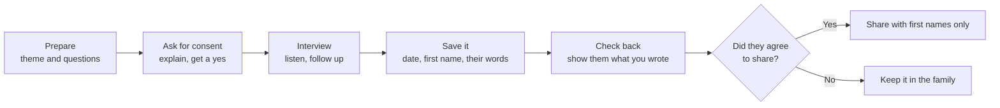

# Chapter 22: Bring It Home

## Summary

This last chapter turns the book back toward you. It starts with identity: how people with roots in South Asia describe themselves, why labels and hyphens matter, and how stereotypes and colorism shape the way others see them. It then asks a question every club meets sooner or later: what is the difference between appreciating a culture and appropriating it, and what does a good ally do? Finally, it gives you the full oral history method (consent, active listening and careful preservation) so the Ask Your Elders interviews you've done across 21 chapters can become something that lasts, for your family, your club and your community.

## Concepts Covered

1. Cultural Identity
2. Hyphenated Identity
3. Third Culture Kids
4. Stereotypes
5. Colorism
6. Cultural Appropriation
7. Cultural Appreciation
8. Intergenerational Dialogue
9. Oral History
10. Informed Consent
11. Active Listening
12. Cultural Preservation
13. Allyship
14. Student Clubs
15. Community Organizing
16. Community Impact

## Prerequisites

This chapter draws on the whole book, but these chapters help most:

- [Chapter 4: Colonialism, Independence, and Partition](../04-colonialism-and-partition/index.md), for why some family memories are painful
- [Chapter 6: Languages and Scripts](../06-languages-and-scripts/index.md), for heritage languages and what happens when they fade
- [Chapter 13: Family, Names, and Life Events](../13-family-names-life-events/index.md), for kinship words and family roles
- [Chapter 21: The South Asian Diaspora](../21-the-diaspora/index.md), for how families came to live outside South Asia

!!! mascot-welcome "Last chapter, biggest project"
    { class="mascot-admonition-img" }
    Hi again, it's Mora! You've spent 21 chapters learning about the region, and maybe 21 conversations learning from the people around you. Right now, the grandparents and great-aunts who remember 1947, 1971, a village festival or a first winter in Minnesota are still here to ask. This chapter shows you how to keep their stories safe and how to use what you've learned to make your school a little better for everyone.

## 22.1 Twenty-One Pages of Nanu

It's the last week of May. The Prairie Ridge South Asian Student Association has one meeting left this year, and Zara Hossain is sitting on her bedroom floor with a stack of notebook pages. There are 21 of them, one for every Ask Your Elders interview she did with her Nanu. One page has the smell of the first monsoon rain in Chattogram. One has the Bangla word for the river ferry. One has a story about 1971 that Nanu told only once, very quietly, and then asked Zara to keep "just for the family."

Zara wants to do something with all of it. A booklet? A club night? A post? But she's not sure what she's allowed to share, or how.

Ben Lindqvist has a different worry. He's been the club's first non-South Asian member all year. He ran the quiz games, learned to count Teentaal and ate more biryani than anyone. Now some new freshmen are asking to join, and one of them asked him, "Is it weird that you're in it?" Ben texts Zara: "How do I help the club without being the guy who takes over? Like, what's my actual job?"

Zara and Ben have two questions between them. How do you turn what you've learned into something that lasts, and how does everyone, whatever their background, take part in a way that's fair? This chapter answers both.

## 22.2 Who Am I? Cultural Identity

Start with something familiar: your favorite playlist. Some songs came from your parents' car, some from friends, some from a movie or a trip. You didn't write any of them, but you chose which ones to keep, and the list keeps changing. Nobody else's playlist is exactly like yours.

Identity works a lot like that.

**Cultural Identity** is a person's sense of belonging to one or more cultural groups, built from family, language, faith, food, place, history and the people around them. It is partly given (you didn't choose your grandparents) and partly chosen (you decide what to carry forward), and it changes over a lifetime.

For a teen with roots in South Asia, it might include a home region like Punjab, Kerala, Kandy or Chattogram, a language a grandparent speaks, a faith or a family's values, festival foods, and a Minnesota suburb with long winters and hockey. None of these makes someone "more" or "less" South Asian. Zara understands Bangla but answers in English, and that bothers her a little. She is not alone: in a Pew Research Center analysis of 2021-23 Census Bureau survey data, 28% of Indian Americans ages 5 and older spoke only English at home. Many heritage speakers understand far more than they say, and that understanding counts.

### Labels and the hyphen

People name this kind of identity in many ways.

| Label | What it usually means | Notes |
|---|---|---|
| Bangladeshi American, Pakistani American, Sri Lankan American, Indian American | Someone in the US with roots in one country | The most specific. Many people prefer naming their own country. |
| South Asian American | Roots anywhere in the eight countries | Common in clubs and archives. It doesn't center one country. |
| Desi | An informal word many in the diaspora use for themselves | Not everyone uses it (see below). |
| Bengali, Punjabi, Tamil, Pashtun | A language or regional community | Often older and more personal than any country name. |

The word desi (देसी, *DAY-see*) comes from Hindi-Urdu and means "of the homeland" or "local." Many young people use it warmly, but not everyone from South Asia uses it or likes it for themselves. So ask people what they call themselves before you choose a label for them.

**Hyphenated Identity** means belonging to two or more cultures at once, sometimes written with a hyphen, as in "Indian-American." The hyphen has a history. In the United States from about 1890 to 1920, "hyphenated American" was a put-down suggesting immigrants were not fully loyal. In March 2019 the Associated Press, whose stylebook many newspapers follow, dropped the hyphen from dual-heritage terms like "Asian American." Some people see the hyphen as a bridge between two homes; others say it makes them sound like half of each. Zara writes "Bangladeshi American." Her cousin in London says "British Bangladeshi." Both are right for them.

### Third culture kids

**Third Culture Kids** are people who spent a large part of their childhood living in a culture different from their parents', usually because a parent's job moved the family between countries. The term comes from Ruth Useem, a sociologist at Michigan State University, who first used it in the 1960s for the children of Americans working abroad. She had developed the idea of a "third culture" with her husband, John Useem, after a year-long research stay in India. The "first culture" is the parents' home culture, the "second" is where the family lives, and the "third" is the blend the child builds from both.

Strictly speaking, children of immigrants who settle in one country, like Zara, aren't usually called third culture kids. But many second-generation teens say the idea fits how they feel: at home in two places, and fully at home in neither. Arjun Reddy, a friend from school, says he's "Hyderabad at dinner and Minnesota at practice."

!!! mascot-thinking "Culture moves"
    { class="mascot-admonition-img" }
    If culture never changed, nobody in South Asia would cook with chilies, which arrived from the Americas, probably with Portuguese traders, in the 1500s. Mixing traditions is what every generation before you did too.

## 22.3 Stereotypes and Colorism

Identity is how you see yourself. Other people also have ideas about you, and some of those ideas are unfair.

**Stereotypes** are fixed, oversimplified beliefs about a whole group of people, applied to every member of it. "South Asian kids are all good at math." "Every South Asian family wants a doctor." "They all speak Indian." (There is no language called "Indian." India alone lists 22 languages in its Constitution's Eighth Schedule, as [Chapter 6](../06-languages-and-scripts/index.md) showed.)

Some stereotypes sound like compliments, but they still hurt. A student who struggles in chemistry may be ashamed to ask for help because everyone "expects" them to be good at it. And every stereotype erases the differences you've read about in this book, between eight countries, dozens of languages and many faiths. Stereotypes also live inside communities: a Punjabi family might joke about Bengalis, or a Pakistani family about Indians, and the other way around.

To push back without starting a fight, try asking a question ("What makes you say that?"), adding a real example ("My cousin is a pastry chef, actually") or naming the range ("South Asia is eight countries. Which one do you mean?"). And never ask the only South Asian student in a room to speak for everyone.

### Colorism

One stereotype deserves its own section, because it often lives inside families.

**Colorism** is prejudice or unfair treatment based on skin tone, usually favoring lighter skin over darker skin, including among people of the same background. The American writer Alice Walker is widely credited with bringing the word into use in the early 1980s, writing about the African American community. The same pattern shows up in many places, including South Asia.

In many South Asian families and media, lighter skin has long been praised and darker skin treated as something to fix. You may have heard an aunty warn a cousin not to play in the sun, or seen matrimonial ads asking for a "fair" bride. Writers and researchers trace this preference to several roots, including older social hierarchies and the legacy of colonial rule.

One well-documented example is Fair & Lovely, a skin-lightening cream made by Hindustan Unilever. It went on sale in India in 1975 and is sold in India, Bangladesh, Pakistan, Sri Lanka and beyond. After years of criticism that its name and ads linked "fair" skin to success, the company renamed it Glow & Lovely in 2020 and said its ads would show women of many skin tones. The cream itself is still sold. The renaming shows that public pressure can change how a company talks about beauty, even when the product stays.

!!! mascot-warning "Be careful with this one"
    { class="mascot-admonition-img" }
    Colorism can be very personal. If you talk about it in a club, talk about patterns and media, not about any member's skin, and never make a joke of it.

## 22.4 Appreciation or Appropriation?

Picture a jacket. In one version, a friend asks to borrow your grandfather's old jacket, learns the story behind it and tells people, "This was Zara's grandfather's." In another, someone takes it without asking, wears it as a joke costume and later sells copies under their own name. It's the same jacket, but the relationship is very different.

**Cultural Appropriation** is when someone, usually from a more powerful or dominant group, takes an element of another group's culture (clothing, symbols, music, sacred practices) in a way that ignores its meaning, gives no credit, or turns it into a costume or product without the community's involvement. It stings most when the people who created a tradition were mocked for the very same thing.

**Cultural Appreciation** is learning about, honoring and taking part in another culture with respect: understanding what something means, being invited or welcome, giving credit, and supporting the people the tradition comes from.

| Situation | Leans toward appreciation | Leans toward appropriation |
|---|---|---|
| Saree, salwar kameez or kurta | A friend's family invites you to a wedding and helps you wear it | Wearing it as a "costume" for a theme party |
| Bindi | Wearing one when invited to a festival by people who explain it | Using it as a sparkly sticker for a music festival look, unaware it has religious meaning for many Hindus |
| Mehndi (henna) | Getting mehndi at a friend's Eid or wedding celebration | Calling it a "tribal tattoo" and selling designs without credit |
| Yoga | Practicing it and learning its roots in South Asian traditions | Marketing it as a brand-new Western fitness invention |
| Food | Learning a friend's family recipe and naming where it comes from | Claiming you "invented" a dish after stripping out what makes it South Asian |

About yoga: it grew out of South Asian religious and philosophical traditions, and in 2014 the United Nations declared 21 June the International Day of Yoga. Yoga is a tradition, not a proven treatment for any disease, and nothing here is medical advice.

When you're not sure, ask yourself: Do I know what this means to the people it comes from? Was I invited? Is it sacred to anyone? Who gets the credit and the money? Would I do this the same way in front of a grandparent from that community?

!!! abstract "Whose Story?"
    People inside South Asian communities don't all agree on where the line is. Many families are thrilled when a non-South Asian friend wears a lehenga to a wedding, and see it as a welcome. Others feel hurt seeing a bindi or a turban used as a costume, especially if they were teased for wearing the same thing at school. Some scholars argue that "appropriation" is used too loosely, since cultures have always borrowed through trade and migration, like chilies, tea and cricket. Others argue that borrowing is different when one side holds much more power and money. The questions above won't settle every case, but they help you think it through with the people most affected.

## 22.5 Being a Good Ally

Back to Ben's question: "What's my actual job?"

**Allyship** is the ongoing practice of supporting a group you are not part of, by listening, learning, showing up and using whatever voice or access you have to back that group, while letting its members lead and speak for themselves. You show it by what you keep doing, over and over.

For Ben, that looks like:

- **Listening first.** When a member describes being stereotyped, he doesn't jump in with "I'm sure they didn't mean it."
- **Doing his homework,** so members don't have to teach him everything.
- **Taking real jobs, not the microphone.** He runs the quiz and sets up chairs. He doesn't present "what Diwali is" to the school while South Asian members sit in the audience.
- **Speaking up where they aren't.** If a hockey teammate mocks an accent, Ben can say "Not funny" in a room no club member is in.
- **Taking correction well.** If he mispronounces a name, he says "Thanks, I'll get it right," and moves on.

Allyship works inside the club too. A Bangladeshi member can be an ally to a Sri Lankan Tamil member, and a Hindu member to a Muslim member. Nima Sherpa, whose family is from Nepal, may notice when "South Asian night" is really just "Indian night" and say so. Being South Asian doesn't make anyone an expert on all of South Asia.

!!! mascot-tip "A simple rule for allies"
    { class="mascot-admonition-img" }
    Back people up instead of replacing them. If you're about to speak for a group, first ask whether someone from that group would rather speak.

So what should Ben tell the freshman? "No, it's not weird. The club is for anyone who wants to learn. My job is to show up, listen and help."

## 22.6 Culture Lives in People: Oral History

Now for Zara's 21 pages.

A book can explain the monsoon, Partition or a wedding custom. It can't tell you what your Nanu smelled on the first rainy morning in Chattogram. That kind of knowledge lives in people, which is why every chapter ended with Ask Your Elders.

**Intergenerational Dialogue** is conversation between people of different generations, such as grandparents, parents and teens, in which each side learns from the other. Teens ask, elders tell, and sometimes elders ask back: "Why does your club do Diwali in October? We did it differently." A structured interview often opens up stories that never come out at the dinner table.

**Oral History** is the practice of recording people's memories of their own lives, in their own words, and keeping those recordings or notes so others can learn from them later. Two people can remember the same day differently, so oral history works alongside documents. It adds what documents leave out, like feelings, daily life and the voices of people who rarely appear in official records.

The Bangla word for "story" is গল্প (*GOL-po*), and the Urdu word is کہانی (*ka-HAA-nee*). Families across South Asia have passed down golpo and kahani for generations without writing them down. Oral history makes sure they aren't lost when the storytellers are gone.

### Oral history projects in South Asia and the diaspora

You won't be the first to do this.

| Project | Where | What it collects |
|---|---|---|
| South Asian American Digital Archive (SAADA) | United States, founded 2008 | Documents and stories of South Asian Americans. Its First Days Project, launched in 2013, collects short stories of people's first days in the US and has gathered hundreds of them. |
| The 1947 Partition Archive | Based in Berkeley, California | Life stories of people who lived through Partition. It reports preserving over 12,000 oral histories, many recorded by volunteer "citizen historians." |
| Liberation War Museum | Dhaka, Bangladesh, established 1996 | Eyewitness accounts of 1971. Since 2007 a mobile exhibit on a bus has visited schools, and students then interview elders and send in what they hear. One of its founding trustees reported more than 60,000 student-collected narratives in 2021. |
| Citizens Archive of Pakistan | Karachi, Pakistan, founded 2007 | Its Oral History Project records memories from across Pakistan; the archive reports more than 5,000 oral histories. |

Notice the Liberation War Museum's method. It's almost exactly what you've been doing: a student learns some history, goes home, asks an elder and writes it down. Tens of thousands of Bangladeshi teens have done what Zara did.

## 22.7 The Method: Consent, Listening, Preservation

The [Oral History Project](../../oral-history.md) page has the short version and a consent script. Here is the full method, with the reasons behind it.

### Step 1: Informed consent

**Informed Consent** means the person you interview understands what you are doing, why, how their words will be used and who might see them, and freely agrees, with the right to skip questions, stop at any time or change their mind later.

The Oral History Association, the main professional group for oral historians in the US, sets out these expectations in its Principles and Best Practices (revised in 2018) and its ethics statement: explain the purpose first, get consent (ideally in writing), tell narrators they can decline any question, and let them review the interview and limit or remove parts before anything is made public.

For a student project, that means:

- **Explain it simply** and say what you'll do with it: notes or audio, and who, if anyone, will see it.
- **Make "no" easy.** "You can skip anything, and we can stop whenever you want."
- **Get a parent or guardian's OK** if you're under 18 and plan to share anything outside the family. The Story Archive requires it.
- **Protect privacy.** First names or initials only. Never share a full name, address, phone number or photo without clear permission.
- **Let consent change.** If Nanu later says, "Don't share that part," you don't.

Nanu asked Zara to keep the 1971 story "just for the family." Informed consent means it stays there. Zara can still use the other 20 pages.

### Step 2: Active listening

**Active Listening** is giving a speaker your full attention and showing that you understand, by focusing on their words, asking follow-up questions, reflecting back what you heard and leaving room for silence, instead of planning what you'll say next.

In an interview, that means:

- **Ask open questions.** "What was a school day like?" gets a story. "Did you like school?" gets "yes."
- **Follow the energy.** If they light up about a ferry ride, ask about the ferry. "What happened next?" and "What did that look like?" bring out the best details.
- **Let silence sit.** Count to five before your next question. Elders often add the best part after a pause.
- **Don't correct.** Memory isn't a test. If their story differs from this book, write the difference down. That's interesting, not wrong.
- **Read the room.** Partition, 1971, the Sri Lankan civil war or leaving home can bring up grief. If someone goes quiet, say "We can stop or move on," and mean it.

If your elder is more comfortable in Bangla, Urdu, Sinhala, Nepali or Pashto, let them answer in that language, and ask a parent to help translate later. You don't need to be fluent to listen well.

!!! mascot-encourage "You're more ready than you think"
    { class="mascot-admonition-img" }
    If you've done even one Ask Your Elders interview in this book, you've already practiced consent and listening. This chapter just adds the "why."

### Step 3: Preservation

**Cultural Preservation** is the work of keeping a community's traditions, knowledge, languages and memories alive for future generations, by recording them, practicing them and passing them on.

In a family, preservation can be a recipe card in Nanu's handwriting or a voice memo of a grandfather singing. For your interviews, label each one with the date, theme and the person's relationship and first name. Keep it in a private folder with a backup, and give the person a copy. Some families make a small printed booklet as a gift.

At a larger scale, UNESCO keeps lists of intangible cultural heritage, meaning living practices rather than buildings, to help protect them:

| Tradition | Country | Added to UNESCO's lists |
|---|---|---|
| Durga Puja in Kolkata | India | 2021 |
| Mangal Shobhajatra, the Pohela Boishakh new year procession in Dhaka (its organizers renamed it Barshabaran Ananda Shobhajatra, close to its first name from 1989, in [April 2025](https://en.prothomalo.com/bangladesh/city/8b8g0qv0ow), and Baishakhi Shobhajatra in [April 2026](https://www.thedailystar.net/culture/news/baishakhi-shobhajatra-turns-vibrant-after-years-disruption-4151416)) | Bangladesh | 2016 |
| Suri Jagek, the Kalasha people's way of reading the sun, moon and stars to plan the farming year | Pakistan | 2018 |
| Rūkada Nātya, string puppet drama | Sri Lanka | 2018, the country's first element |
| Drametse Ngacham, the mask dance of the drums from Drametse | Bhutan | proclaimed 2005, inscribed 2008 |

When the Drametse mask dance was first proclaimed, the listing noted that fewer people were practicing it, partly because young people were losing interest. Lists help, but a tradition survives only when people, often young people, keep doing it.

Preservation is not the same as freezing. Durga Puja in Kolkata today, with its giant themed pandals, looks different from a century ago, and it's still Durga Puja. A family that serves biryani next to the turkey at Thanksgiving is keeping its culture alive by adapting it.

## 22.8 Bring It Home: Clubs, Organizing and Impact

The last step is the one in the chapter's title: doing something with what you've learned.

**Student Clubs** are student-run groups at a school, usually with a faculty advisor, that meet regularly around a shared interest or identity. A South Asian Student Association is one kind. Clubs give students a place to belong and a chance to practice leading. Under a 2023 Minnesota law, every Minnesota public high school must offer an ethnic studies course starting this school year, 2026-27 (it is not a graduation requirement), and a club can be a natural partner for that class. The [Club Kit](../../club-kit.md) has a two-year plan of 45-minute meetings mapped to the chapters, officer roles, food and allergy notes, and a guide to Ask Your Elders nights.

**Community Organizing** is people working together, in a planned way, toward a shared goal for their community, by finding out what people need, building relationships, dividing up the work and acting together. For a club, it might go like this:

1. **Listen first.** Maybe new students from Nepal feel invisible, or the library has no books by Pakistani or Sri Lankan authors.
2. **Pick one goal.** "A South Asian author display during Mother Language Day week."
3. **Build relationships.** Meet the librarian, and invite another club, such as the Black Student Union, to co-host.
4. **Divide the work and act.** One person makes the book list, one checks dates, one makes posters.
5. **Reflect.** Ask what worked and what didn't.

**Community Impact** is the real difference a project makes in people's lives, the changes you can see or measure, not just how busy you were. Ten meetings is activity. Five new members who say they finally feel they belong is impact.

| Activity (what you did) | Impact (what changed) |
|---|---|
| Held an Ask Your Elders night | Elders said nobody had asked about their childhood before; three families started their own story booklets |
| Ran Two Truths and a Myth for a middle school class | Students could name all eight countries afterward |
| Collected 12 stories for a family booklet | Grandparents and grandchildren now share a printed copy of stories that lived only in memory |

A simple habit: before each project, write down one question you'll ask and one number you'll count, then check them afterward.

At the last meeting, Zara brings a stapled booklet, "Nanu's Stories, Year One." It has 20 stories, not 21; the 1971 page stayed home, as promised. Nanu comes too, and when Zara reads the ferry story aloud, she adds a detail nobody had heard before. Ben runs the "best of the year" Jeopardy game and makes sure the Nepal category is worth as many points as the India one. When a freshman asks how to join, he points at Zara and Simran Kaur Gill, the treasurer: "Talk to them. They run it. I just help."

#### Diagram: Interview Builder

<iframe src="../../sims/ch22-interview-builder/main.html" height="762px" width="100%" scrolling="no"></iframe>

[Open the Interview Builder fullscreen](../../sims/ch22-interview-builder/main.html){ .md-button .md-button--primary }

MicroSim specification: Interview Builder

**sim-id:** ch22-interview-builder 
**Library:** p5.js 
**Status:** Implemented 
**Bloom Level:** Create 
**Bloom Verb:** design 
**Learning Objective:** The learner will design an ethical oral history interview plan, with a consent script, theme questions, follow-up prompts and a note-taking grid, for a chosen theme, narrator and length.

**Canvas:** responsive width; 640 px drawing area plus 120 px control area.

**Controls:** Theme menu (the 21 chapter themes plus a "life story" capstone), Narrator menu (grandparent, parent, aunt or uncle, community member), Length menu (10, 20 or 30 minutes), New questions button, Print plan button; click or tap the Consent, Questions and Notes tabs on the canvas.

**Behavior:** A plain-text question bank in the sim, written from each chapter's Ask Your Elders topics, feeds a plan of 6, 8 or 10 questions (a warm-up, theme questions, a "how has it changed" question and a closing question), plus a consent script adjusted for the narrator, follow-up prompts and a note grid. Print calls window.print() on a clean, print-only layout. Nothing is saved or sent anywhere.

Choose the chapter you enjoyed most and the person you want to interview. Read the Consent tab first, and notice how the script changes when you switch from a grandparent to a community member. Then open the Questions tab and change the length: a 10-minute plan keeps only a few theme questions, while a 30-minute plan adds room to warm up and reflect.

Press **New questions** to see other questions from the same theme, then **Print plan** and take the page to your interview. Notice what never changes, whatever you pick: a consent script, the right to skip questions and the rule of first names only.

## Ask Your Elders

!!! note "Your interview for this chapter"
    Talk with a parent, grandparent, aunt, uncle, family friend or community elder about their life story: where they grew up, the moments that changed their life, what they carried with them and what they hope the next generation keeps. This is the capstone, a full oral history interview using everything in this chapter. If you don't have a South Asian elder to ask, interview a club advisor, a local temple, mosque, gurdwara or cultural center volunteer, or a classmate's family (with permission). Ten minutes is enough.

**Before you start:** Use the Interview Builder to print a plan with the "Life story" theme, read the consent script aloud first, and ask whether you may take notes or record audio. Bring a photo or object from their past if they have one.

**Questions to ask**

1. What is your earliest memory? Where were you, and who was with you?
2. Who were the most important people in your life when you were my age, and what did they teach you?
3. What was the biggest change you lived through, and how did it change your everyday life?
4. Is there a tradition, recipe, song or saying from your childhood that you still keep? Why that one?
5. How have you changed since you were young, or since you moved to a new place? What surprised you most?
6. What do you hope I, and people my age, keep from your life and from our family's traditions?

**Listen for:** moments where they describe their Cultural Identity changing over time, signs of Intergenerational Dialogue (stories passed down from their own elders), and anything they say they want kept, which is Cultural Preservation in their own words.

**Save it:** Write down one quote or story in their words, with their permission. If they agree, you can share it with the [Roots & Rivers Story Archive](../../oral-history.md).

??? question "Your turn: compare two answers"
    Look back at an earlier Ask Your Elders interview you did, from any chapter. Compare it with this life-story interview: did the same person tell a story differently, or add something new, when asked about their whole life instead of one topic? If a friend interviewed someone from a different country or generation, compare what each elder said they most want kept.

*"Every family does it a little differently, and there is no wrong answer here."*

## Common Misconceptions

**Myth:** Culture is fixed. If you change a tradition, you lose it.  
**Reality:** Cultures have always changed through trade, migration and new ideas. Chilies came from the Americas, and Durga Puja and Eid celebrations look different in each generation. Adapting a tradition to a new home is a normal part of keeping it alive.

**Myth:** Appreciation and appropriation are the same thing, so it's either all fine or all wrong.  
**Reality:** The difference lies in meaning, invitation, credit and power. Wearing a saree to a friend's wedding when invited is very different from wearing a bindi as a party costume or selling a tradition without credit.

**Myth:** You need to speak your heritage language fluently to really belong.  
**Reality:** Many heritage speakers understand more than they speak, and in 2021-23, 28% of Indian Americans ages 5 and older spoke only English at home (Pew Research Center). Belonging grows from connection and relationships, and nobody has to pass a language test first.

**Myth:** One person's story speaks for the whole community.  
**Reality:** Every oral history is one person's experience and memory. A Partition story from one family in Lahore and another from a family in Amritsar can both be true and still be very different. That's why oral historians collect many voices.

**Myth:** Being an ally means speaking for the group you support.  
**Reality:** Allyship means listening, showing up and backing a group's members while they speak for themselves. Allies use their voice most in rooms where those members aren't present.

## Check Yourself

??? question "1. What is the difference between cultural identity and a stereotype?"
    Cultural identity is a person's own sense of belonging to cultural groups, partly given and partly chosen. A stereotype is a fixed, oversimplified belief that outsiders (or insiders) apply to every member of a group.

??? question "2. Why did the Associated Press drop the hyphen from terms like \"Asian American\" in 2019?"
    AP made the change after talking with journalists and community groups. Many argued that the hyphen splits a person's identity in half, and it echoes the old "hyphenated American" put-down that questioned immigrants' loyalty. Without the hyphen, the heritage word simply describes the American.

??? question "3. Name two things that separate cultural appreciation from cultural appropriation."
    Any two of: understanding the meaning, being invited or welcome, giving credit, making sure the community benefits, and treating sacred items with care instead of as costumes.

??? question "4. What does informed consent require in an oral history interview?"
    The person must understand what the project is, how their words will be used and who may see them, and must freely agree. They can skip questions, stop at any time and change their mind later, and they should be able to review what is shared.

??? question "5. Give one example of activity and one example of impact for a student club."
    Activity: holding an Ask Your Elders night. Impact: elders said they had never been asked about their childhood, and families started their own story booklets. (Other pairs that show a real, visible change also work.)

## Exercises

### Remember

1. List the three steps of the oral history method described in Section 22.7.

    ??? note "Answer"
        Informed consent, active listening and preservation (keeping the record safe and giving it back to the narrator).

2. Name two oral history projects from this chapter and the country where each is based.

    ??? note "Answer"
        Any two of: SAADA and its First Days Project (United States), The 1947 Partition Archive (United States, Berkeley), the Liberation War Museum (Bangladesh, Dhaka), the Citizens Archive of Pakistan (Pakistan, Karachi).

### Understand

3. Explain in your own words why children of immigrants who settle in one country are usually not called third culture kids, and why many still relate to the idea.

    ??? note "Answer"
        Strictly, third culture kids grow up moving between countries because of a parent's job, and the term isn't usually used for permanent immigrants. Many second-generation teens still relate because they also build a blended "third" culture between their parents' home culture and the one they live in.

4. Explain why "preservation" doesn't mean keeping a tradition exactly the same forever.

    ??? note "Answer"
        Living traditions change as people practice them in new times and places. Preservation means keeping the knowledge, meaning and practice alive and passed on, which often requires adapting, like celebrating Eid or Durga Puja in a new setting.

### Apply

5. Use the Interview Builder to create a 20-minute plan for the theme you enjoyed most in this book. Print it (or save it as a PDF), then mark one question you would cut and one you would add for your specific narrator.
    *Hint: think about what your narrator knows best and what might be painful for them.*

6. A classmate says, "You're Pakistani, so you must love spicy food and be good at cricket." Write a short, calm reply that uses one of the moves from Section 22.3.
    *Hint: asking a question or adding a real example often works better than arguing.*

### Analyze

7. Compare the Liberation War Museum's student oral history program with the Ask Your Elders method in this book. Identify two ways they are alike and one risk that comes with student-collected history.
    *Hint: think about who asks, who answers and how stories are checked.*

8. Look at the Fair & Lovely to Glow & Lovely renaming in 2020. Analyze what changed and what stayed the same, and what that suggests about how colorism can (and can't) be changed by a company.
    *Hint: separate the name and ads from the product and the beliefs behind it.*

### Evaluate

9. Choose two rows from the appreciation and appropriation table in Section 22.4. For each, judge whether the "appreciation" column is enough, or whether you'd add a condition. Defend your choices.
    *Hint: the Whose Story? box shows that people in the community disagree.*

10. A club officer wants to post a member's grandmother's Partition story on the club's Instagram because "it's so powerful." Evaluate this plan using the rules of informed consent and privacy.
    *Hint: who agreed to what, and who might see it?*

### Create

11. Design a one-semester community organizing plan for your club with one clear goal, a list of partners, a division of work and one way to measure community impact.
    *Hint: use the five organizing steps and the activity versus impact table.*

12. Conduct the capstone life-story interview from Ask Your Elders, then create a one-page "story card" from it: a title, the narrator's first name or relationship, one story in their words (with permission), and one sentence on what you learned about your own cultural identity.
    *Hint: show the card to your narrator before sharing it with anyone.*

## Key Takeaways

- Cultural identity is partly given and partly chosen, and it changes over a lifetime. Labels like "South Asian American," "Bangladeshi American" or "desi" are personal, so ask people what they call themselves.
- Stereotypes, even ones that sound like compliments, erase the huge variety within South Asia. Colorism, a preference for lighter skin, is a stereotype that often lives inside families and media.
- Appreciation and appropriation differ in meaning, invitation, credit and power. Allyship means listening, showing up and backing others while they speak for themselves.
- Oral history records people's memories in their own words. Projects in the United States, Pakistan and Bangladesh have collected thousands of these stories, many gathered by students or volunteers.
- Good oral history rests on informed consent, active listening and careful preservation: explain, get a real yes, follow the story, use first names only and give the story back.
- Cultural preservation keeps traditions alive by practicing and adapting them, not by freezing them.
- Student clubs can turn learning into community organizing and real community impact. The [Club Kit](../../club-kit.md) and [Oral History Project](../../oral-history.md) pages show you how to start.

!!! mascot-celebration "You brought it home!"
    { class="mascot-admonition-img" }
    You've finished all 22 chapters, and every tradition you met had a story behind it. Now go find the ones in your own family, ask with care, and keep them safe. That's the next chapter, and you get to write it.
