# MicroSims

Every chapter has one interactive simulation. They work on phones and computers, need no login, and save nothing about you. Click a picture to open the sim.

-   [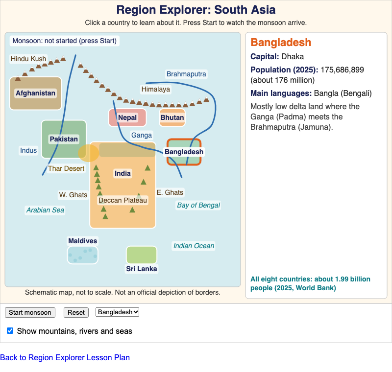](ch01-region-explorer/index.md)

    **[Region Explorer](ch01-region-explorer/index.md)**

    A schematic tile map of the eight countries of South Asia, with mountains, rivers, seas and an animated southwest monsoon.

    *Chapter 1: [What Is South Asia?](../chapters/01-what-is-south-asia/index.md)*

-   [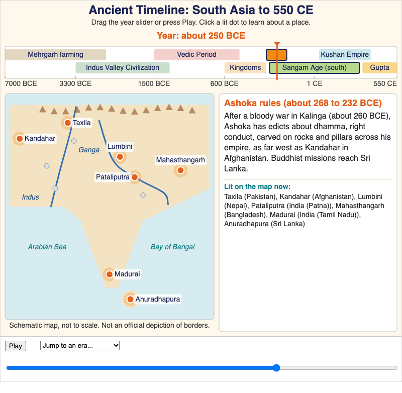](ch02-ancient-timeline/index.md)

    **[Ancient Timeline](ch02-ancient-timeline/index.md)**

    A scrubbable timeline of South Asia from about 7000 BCE to 550 CE, linked to a schematic map of eleven ancient places.

    *Chapter 2: [Ancient Roots](../chapters/02-ancient-roots/index.md)*

-   [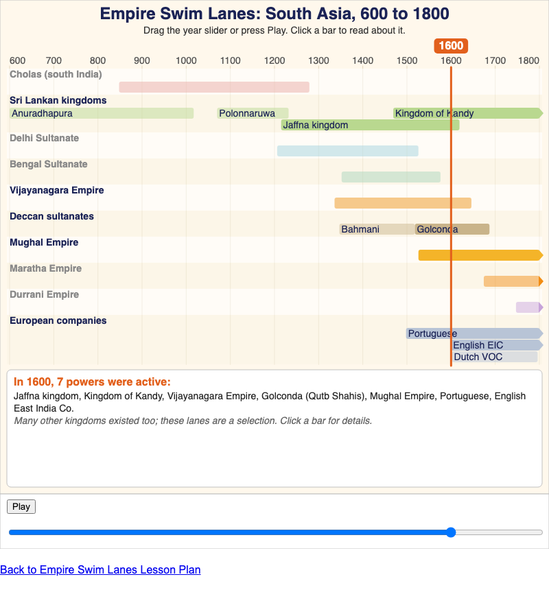](ch03-empire-timeline/index.md)

    **[Empire Swim Lanes](ch03-empire-timeline/index.md)**

    A swim-lane timeline of ten South Asian powers from 600 to 1800 CE, with a moving year line that shows which powers existed at the same time.

    *Chapter 3: [Empires and Encounters](../chapters/03-empires-and-encounters/index.md)*

-   [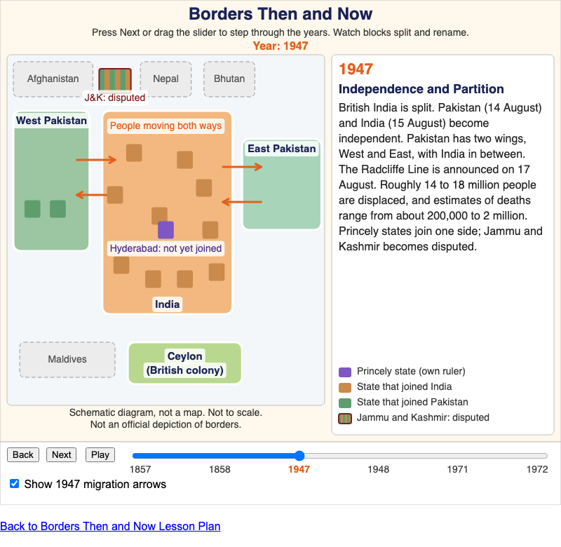](ch04-borders-then-and-now/index.md)

    **[Borders Then and Now](ch04-borders-then-and-now/index.md)**

    A schematic block diagram showing how British India, the princely states and Ceylon became India, Pakistan, Bangladesh and Sri Lanka between 1857 and 1972.

    *Chapter 4: [Colonialism, Independence, and Partition](../chapters/04-colonialism-and-partition/index.md)*

-   [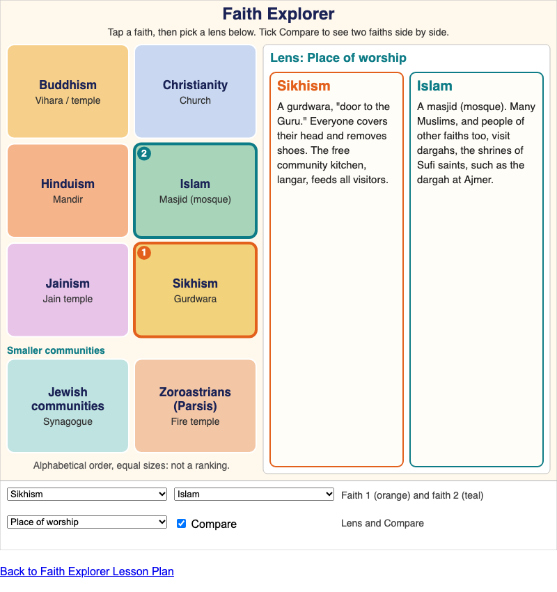](ch05-faith-explorer/index.md)

    **[Faith Explorer](ch05-faith-explorer/index.md)**

    Compare eight South Asian faith traditions through the same five lenses (origins, sacred texts, place of worship, a major festival, a core idea) without ranking them.

    *Chapter 5: [Faiths of South Asia](../chapters/05-faiths-of-south-asia/index.md)*

-   [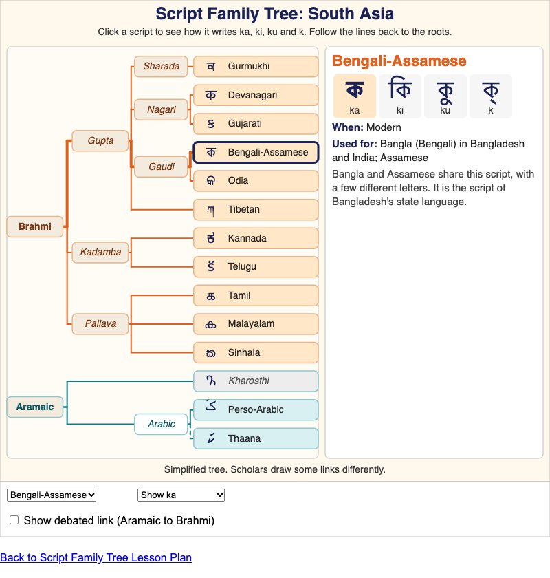](ch06-script-family-tree/index.md)

    **[Script Family Tree](ch06-script-family-tree/index.md)**

    A simplified family tree of South Asian scripts, from Brahmi and Aramaic to the scripts used today, showing how each one writes ka, ki, ku and k.

    *Chapter 6: [Languages and Scripts](../chapters/06-languages-and-scripts/index.md)*

-   [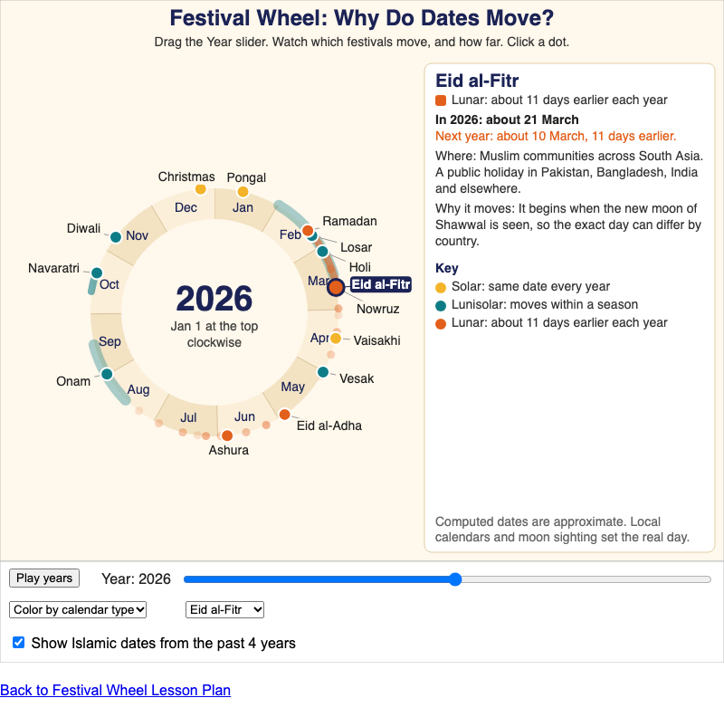](ch07-festival-wheel/index.md)

    **[Festival Wheel](ch07-festival-wheel/index.md)**

    A 12-month calendar wheel of South Asian festivals that shows why solar, lunisolar and lunar festival dates move in different ways.

    *Chapter 7: [Festivals Through the Year](../chapters/07-festivals/index.md)*

-   [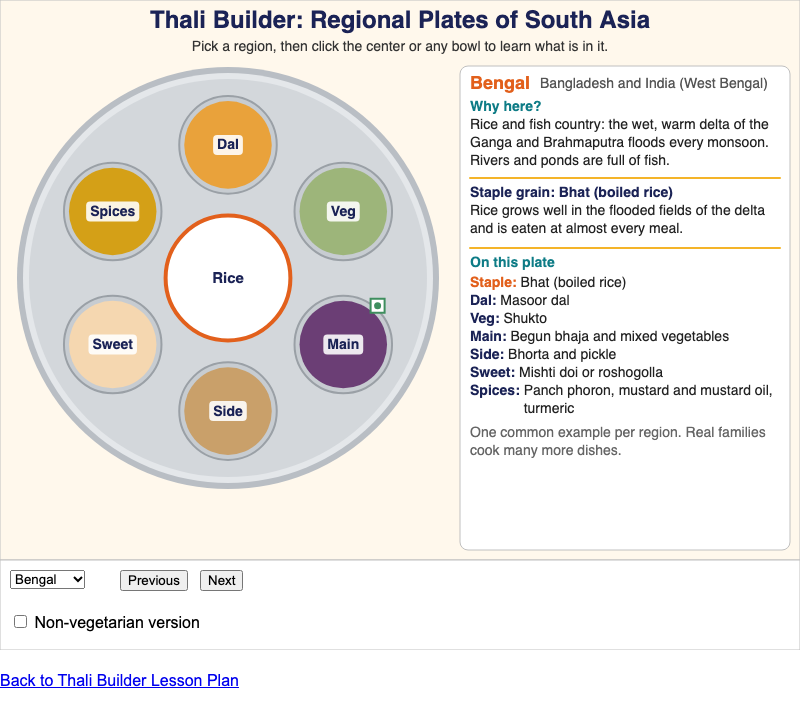](ch08-thali-builder/index.md)

    **[Thali Builder](ch08-thali-builder/index.md)**

    Compare the thalis of seven South Asian regions and connect each plate's grain, dal, vegetables, main dish, sweet and spices to climate, crops and trade.

    *Chapter 8: [Food and the Table](../chapters/08-food-and-the-table/index.md)*

-   [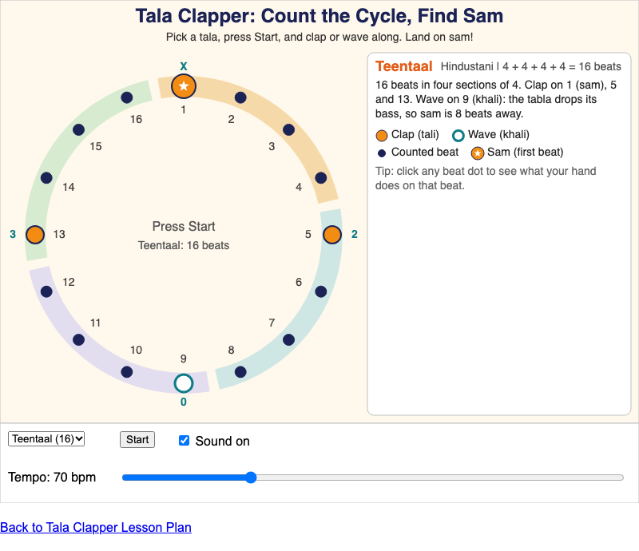](ch09-tala-clapper/index.md)

    **[Tala Clapper](ch09-tala-clapper/index.md)**

    Count a full cycle of Teentaal, Rupak, Dadra or the Carnatic Adi tala, follow the claps, waves and finger counts, and land on sam.

    *Chapter 9: [Music](../chapters/09-music/index.md)*

-   [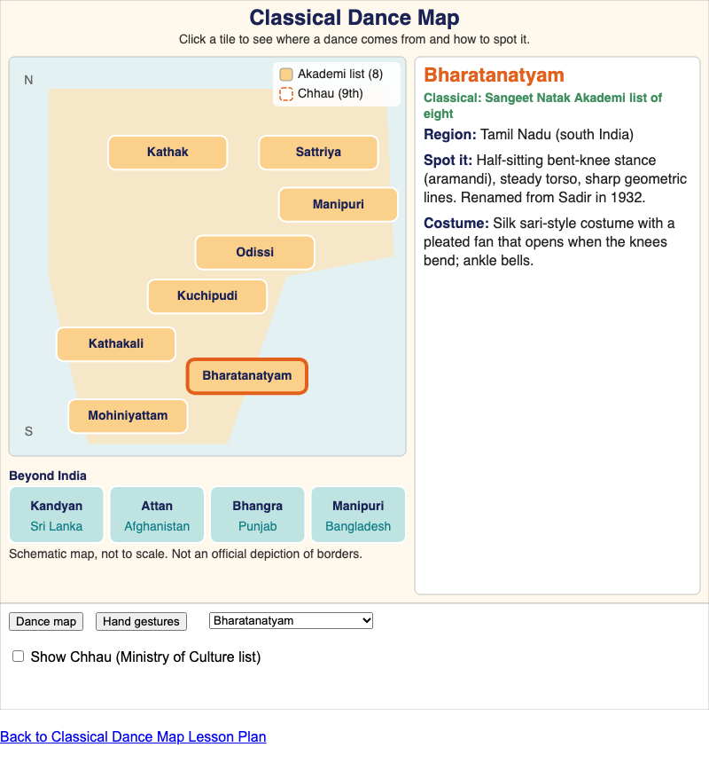](ch10-classical-dance-map/index.md)

    **[Classical Dance Map](ch10-classical-dance-map/index.md)**

    A schematic tile map of the eight classical dances recognized by India's Sangeet Natak Akademi, dances beyond India, and six basic hand gestures (mudras).

    *Chapter 10: [Dance and Theater](../chapters/10-dance-and-theater/index.md)*

-   [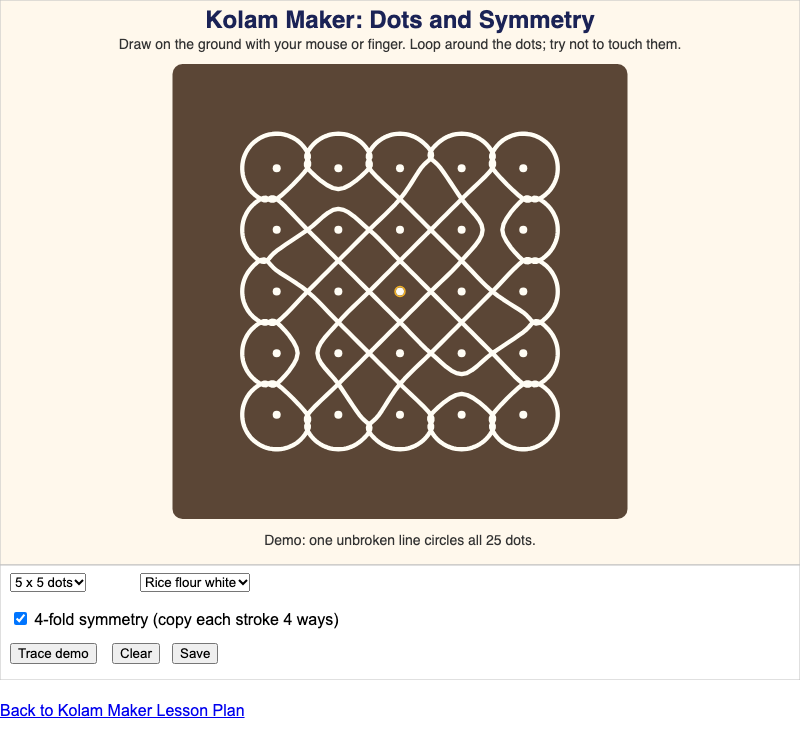](ch11-kolam-maker/index.md)

    **[Kolam Maker](ch11-kolam-maker/index.md)**

    Draw your own kolam on a grid of dots, with 4-fold rotational symmetry, and watch a pulli kolam demo trace one line around every dot.

    *Chapter 11: [Art, Architecture, and Craft](../chapters/11-art-architecture-craft/index.md)*

-   [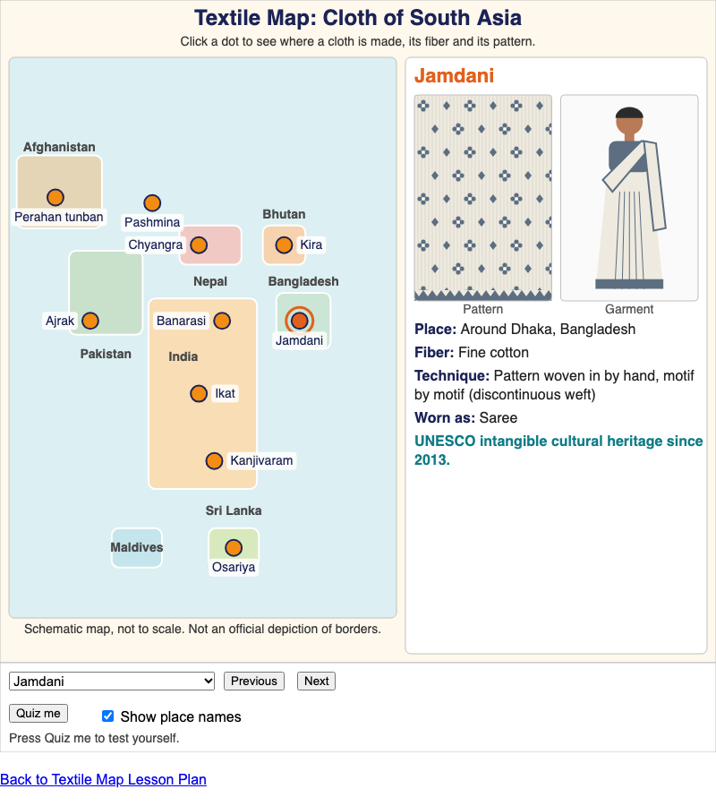](ch12-textile-map/index.md)

    **[Textile Map](ch12-textile-map/index.md)**

    A schematic tile map of South Asia with ten famous textiles and garments, each with its place, fiber, technique, a garment drawing and a pattern swatch.

    *Chapter 12: [Clothing and Textiles](../chapters/12-clothing-and-textiles/index.md)*

-   [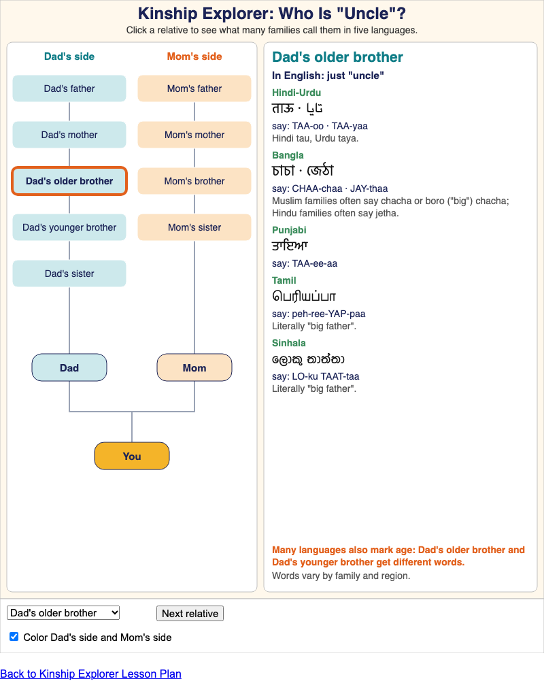](ch13-kinship-explorer/index.md)

    **[Kinship Explorer](ch13-kinship-explorer/index.md)**

    A family tree centered on You that shows what many families call each relative in Hindi-Urdu, Bangla, Punjabi, Tamil and Sinhala, compared with the single English word.

    *Chapter 13: [Family, Names, and Life Events](../chapters/13-family-names-life-events/index.md)*

-   [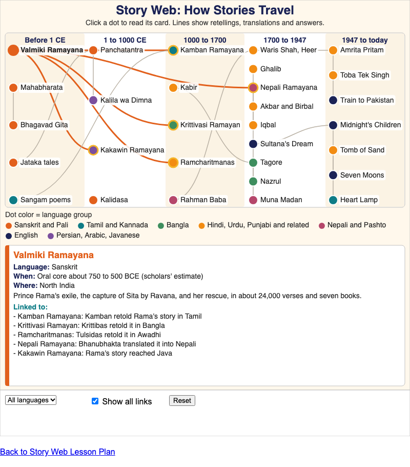](ch14-story-web/index.md)

    **[Story Web](ch14-story-web/index.md)**

    A timeline network of about thirty South Asian works and writers, colored by language, showing how stories travel across languages, faiths and borders.

    *Chapter 14: [Stories and Literature](../chapters/14-stories-and-literature/index.md)*

-   [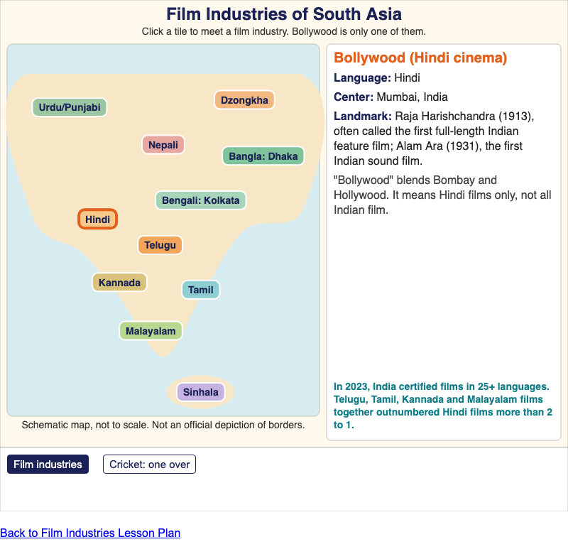](ch15-film-industries/index.md)

    **[Film Industries Map and Cricket Basics](ch15-film-industries/index.md)**

    A schematic tile map of eleven language-based film industries across South Asia, plus an animated cricket over showing 6 legal balls and how runs add up.

    *Chapter 15: [Cinema, Cricket, and Pop Culture](../chapters/15-cinema-cricket-pop-culture/index.md)*

-   [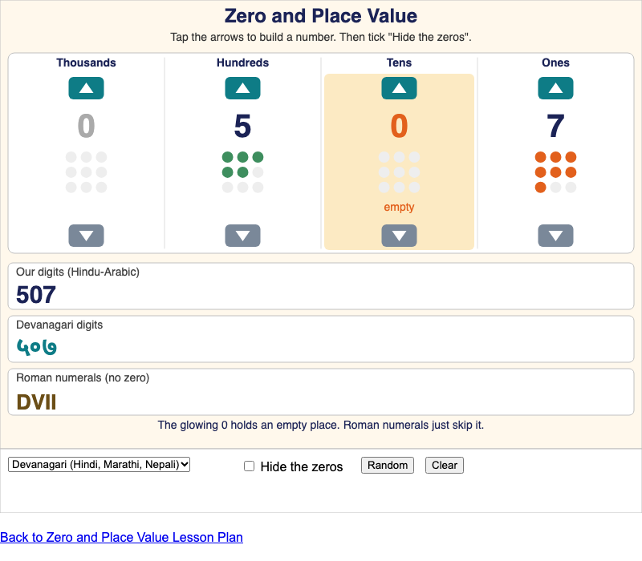](ch16-zero-place-value/index.md)

    **[Zero and Place Value](ch16-zero-place-value/index.md)**

    Build a number and see it as a place value table, in South Asian digits and in Roman numerals, then hide the zeros to see why zero matters.

    *Chapter 16: [Science, Math, and Ideas](../chapters/16-science-math-ideas/index.md)*

-   [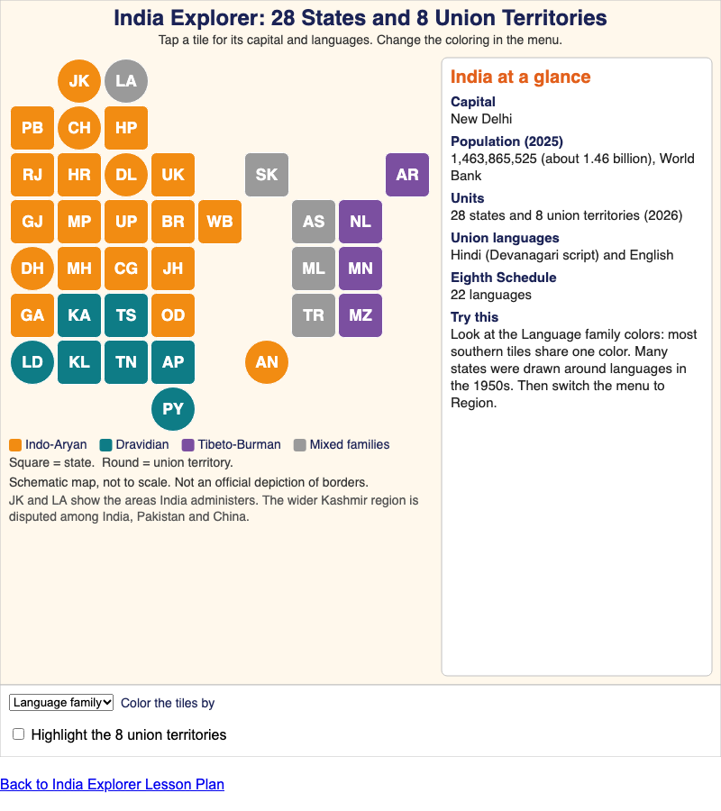](ch17-india-explorer/index.md)

    **[India Explorer](ch17-india-explorer/index.md)**

    A tile cartogram of India's 28 states and 8 union territories, colored by language family or region, with each place's capital and official languages.

    *Chapter 17: [India](../chapters/17-india/index.md)*

-   [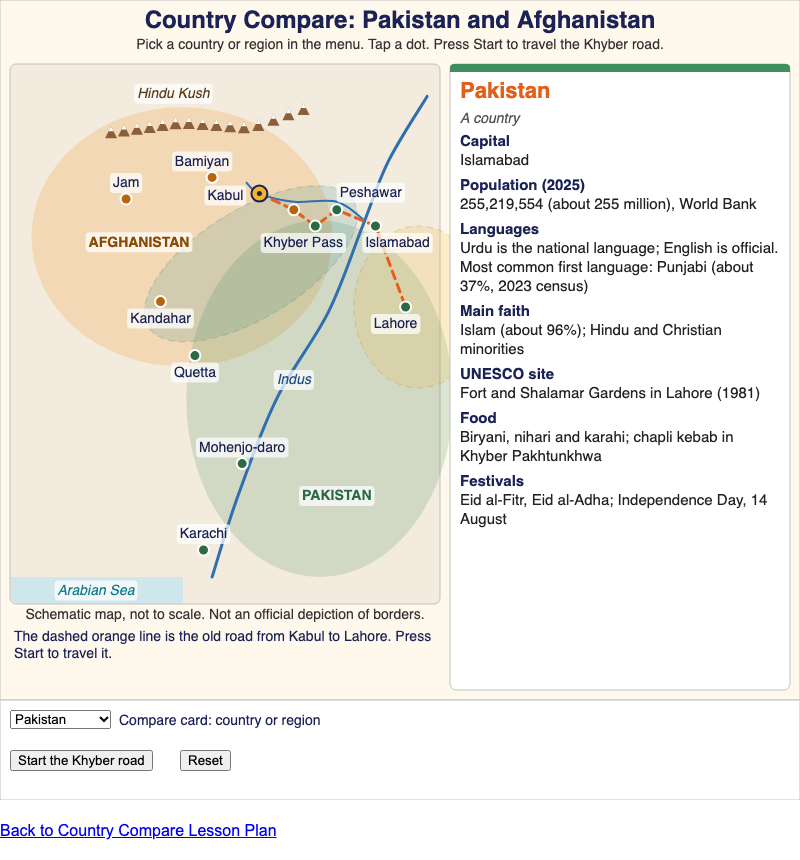](ch18-pakistan-afghanistan-compare/index.md)

    **[Country Compare](ch18-pakistan-afghanistan-compare/index.md)**

    A schematic map and comparison card for Pakistan and Afghanistan, plus two cultural regions that cross the border, with an animated trip along the Khyber road.

    *Chapter 18: [Pakistan and Afghanistan](../chapters/18-pakistan-and-afghanistan/index.md)*

-   [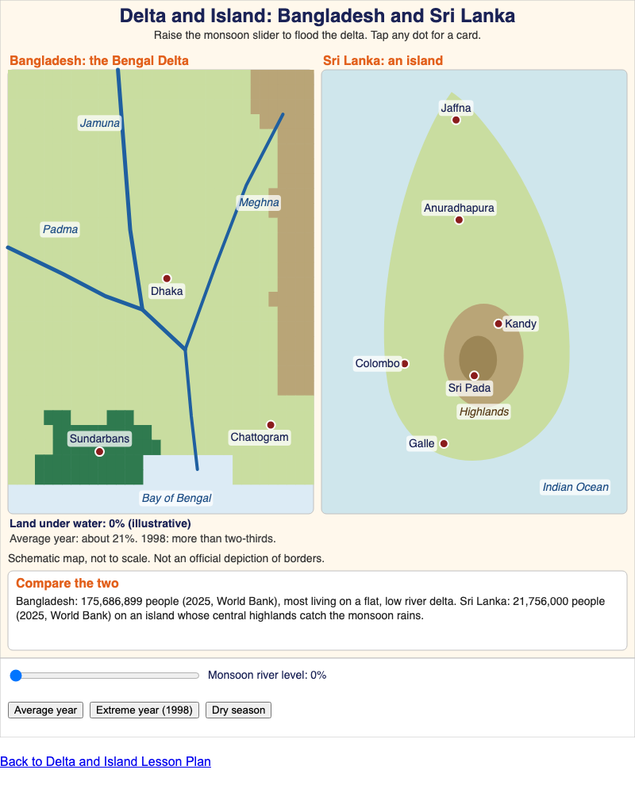](ch19-bangladesh-srilanka-compare/index.md)

    **[Delta and Island](ch19-bangladesh-srilanka-compare/index.md)**

    A schematic Bengal Delta with a monsoon flood slider beside a stylized island of Sri Lanka with its highlands and key places, to show how geography shapes life in each country.

    *Chapter 19: [Bangladesh and Sri Lanka](../chapters/19-bangladesh-and-sri-lanka/index.md)*

-   [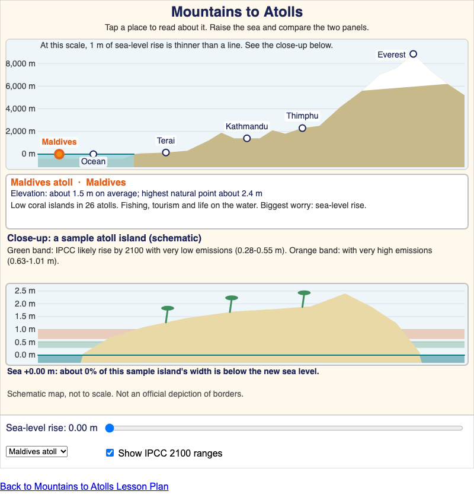](ch20-mountains-to-atolls/index.md)

    **[Mountains to Atolls](ch20-mountains-to-atolls/index.md)**

    A schematic elevation staircase from a Maldives coral atoll to Mount Everest, with a sea-level slider that shows why under a meter of rise matters to low islands.

    *Chapter 20: [Nepal, Bhutan, and the Maldives](../chapters/20-nepal-bhutan-maldives/index.md)*

-   [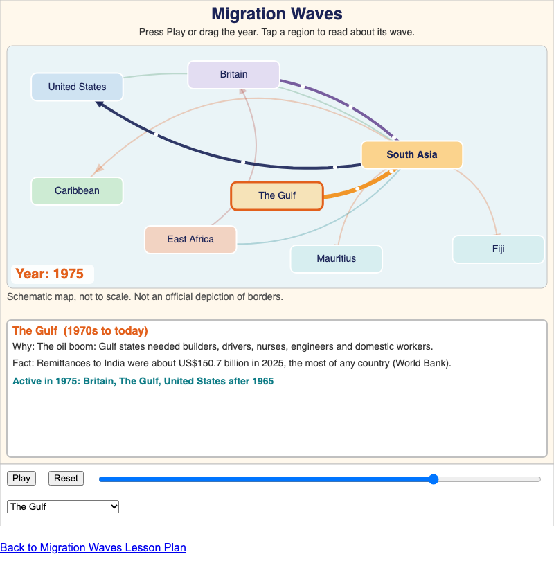](ch21-migration-waves/index.md)

    **[Migration Waves](ch21-migration-waves/index.md)**

    A schematic diagram of labeled region tiles showing the major waves of South Asian migration from 1830 to 2020, with the cause and one sourced fact for each.

    *Chapter 21: [The South Asian Diaspora](../chapters/21-the-diaspora/index.md)*

-   

    **[Interview Builder](ch22-interview-builder/index.md)**

    Build and print an ethical oral history interview plan, with a consent script, theme questions, follow-up prompts and a note-taking grid, for any chapter of Roots & Rivers.

    *Chapter 22: [Bring It Home](../chapters/22-bring-it-home/index.md)*

You can also explore the [Learning Graph Viewer](graph-viewer/main.html), a map of all 368 concepts in the book.
